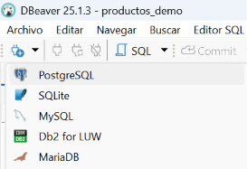
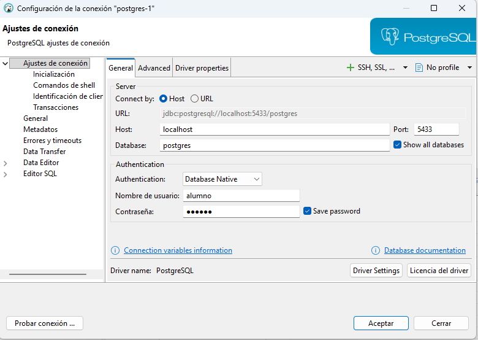
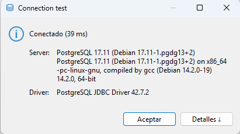
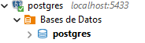
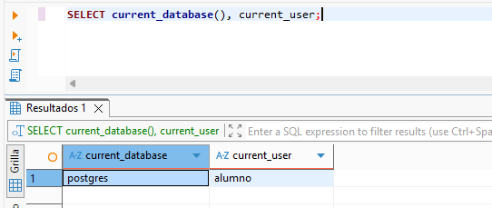

# Cliente PostgreSQL con Dbeaver

**DBeaver Community** será el cliente con el que crearás tablas y ejecutarás consultas. PostgreSQL se ejecuta en el contenedor preparado en [PostgreSQL local con Docker Compose](entorno_postgresql.md).

## 3.1 Instalación

Descarga [DBeaver Community](https://dbeaver.io/download/) para tu sistema operativo, ejecuta el instalador y sigue sus instrucciones. Cuando termine, abre DBeaver.

## 3.2 Conexión

Comprueba que el contenedor de PostgreSQL está en marcha y sigue estos pasos en DBeaver.

<div class="connection-step" markdown>

#### Paso 1. Crear una conexión PostgreSQL

Abre el desplegable de **Nueva conexión** y selecciona **PostgreSQL**.

{ .connection-menu }

</div>

<div class="connection-step" markdown>

#### Paso 2. Introducir los datos del servidor

Completa los campos de la conexión con los valores definidos para nuestro contenedor:

| Campo | Valor |
| --- | --- |
| Host | `localhost` |
| Puerto | `5433` |
| Base de datos | `postgres` |
| Usuario | `alumno` |
| Contraseña | `alumno` |

La configuración debe quedar como en esta captura:

{ .connection-capture }

!!! warning "Selecciona Show all databases"
    En esta misma configuración, marca **Show all databases** (Mostrar todas las bases de datos). Así podrás ver las bases de datos que vayamos creando: `pruebas`, `moviles` y `juegos`. Después de crear cada una, actualiza la conexión en el navegador de DBeaver para que aparezca.

</div>

<div class="connection-step" markdown>

#### Paso 3. Probar y guardar la conexión

Pulsa **Probar conexión**. Si DBeaver solicita descargar el controlador de PostgreSQL, acepta la descarga y vuelve a probar. Cuando la prueba sea correcta, guarda la conexión.

{ .connection-capture }

</div>

<div class="connection-step" markdown>

#### Paso 4. Abrir la conexión y localizar postgres

La conexión guardada aparece en el **Navegador de bases de datos**. Haz doble clic sobre ella para conectarte y despliega **Bases de Datos**.

{ .connection-tree }

En la imagen se ve la conexión a `localhost:5433` y la base inicial `postgres`: DBeaver ha podido acceder al servidor del contenedor y mostrar sus bases de datos.

Distingue los dos niveles:

- **Entrada superior:** la conexión guardada en DBeaver.
- **Entrada `postgres` dentro de Bases de Datos:** la base de datos del servidor. Más adelante aparecerán aquí las que vayamos creando.

</div>

## 3.3 Comprobación

En el **Navegador de bases de datos** de DBeaver, haz clic con el botón derecho sobre la conexión que acabas de crear y selecciona **Editor SQL → Nuevo script SQL**. En la pestaña que se abre, escribe la siguiente consulta y ejecútala con **Ctrl + Intro**:

```sql
SELECT current_database(), current_user;
```

El resultado debe mostrar la base de datos `postgres` y el usuario `alumno`. Son los valores que configuramos en `compose.yaml` mediante `POSTGRES_DB` y `POSTGRES_USER`: PostgreSQL crea esa base de datos y ese usuario al iniciar el contenedor por primera vez con el volumen de datos vacío.

El **nombre de la conexión** es solo una etiqueta para identificarla en DBeaver. Por ejemplo, si cambias su nombre de `postgres` a `Pruebas`, seguirá conectándose a `postgres`: renombrarla no crea una base de datos ni cambia su destino. La base a la que accede se indica en el campo **Base de datos** de la configuración de la conexión. Puedes comprobar cuál estás utilizando con `SELECT current_database();`.




