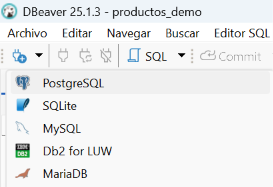
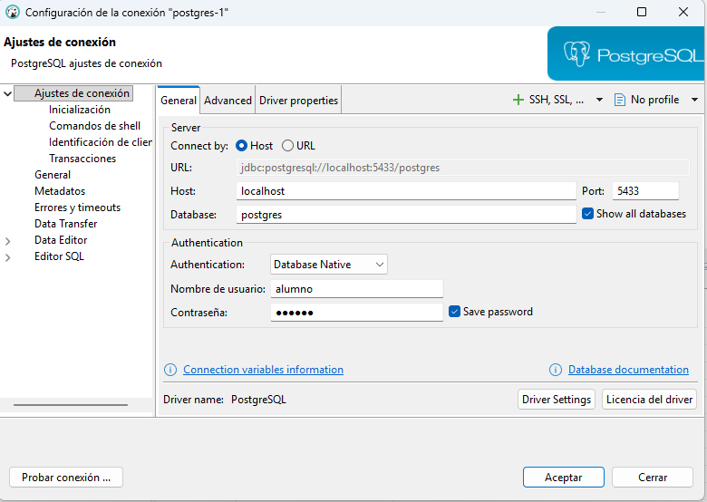
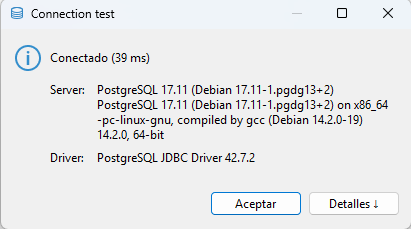
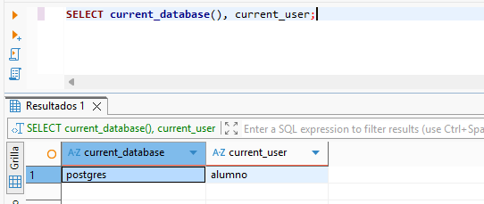

# Cliente PostgreSQL con Dbeaver

**DBeaver Community** será el cliente con el que crearás tablas y ejecutarás consultas. PostgreSQL se ejecuta en el contenedor preparado en [PostgreSQL local con Docker Compose](entorno_postgresql.md).

## 3.1 Instalación

Descarga [DBeaver Community](https://dbeaver.io/download/) para tu sistema operativo, ejecuta el instalador y sigue sus instrucciones. Cuando termine, abre DBeaver.

## 3.2 Conexión

Comprueba que el contenedor de PostgreSQL está en marcha. En DBeaver, abre el desplegable de **Nueva conexión** y elige **PostgreSQL**:



Introduce estos datos:

<div class="image-pair-grid" markdown>

<div markdown>

| Campo | Valor |
| --- | --- |
| Host | `localhost` |
| Puerto | `5433` |
| Usuario | `alumno` |
| Contraseña | `alumno` |
| Base de datos inicial | `postgres` |

</div>

<div class="image-panel" markdown>



</div>

</div>

!!! warning "Mostrar todas las bases de datos"
    En la configuración de la conexión, marca **Show all databases** (Mostrar todas las bases de datos). Así podrás ver las bases de datos que vayamos creando durante el curso: `pruebas`, `moviles` y `juegos`.

    Después de crear una base de datos, actualiza la conexión en el navegador de DBeaver para que aparezca.

Pulsa **Probar conexión**, descarga el controlador si se solicita y guarda. 


## 3.3 Comprobación

En el **Navegador de bases de datos** de DBeaver, haz clic con el botón derecho sobre la conexión que acabas de crear y selecciona **Editor SQL → Nuevo script SQL**. En la pestaña que se abre, escribe la siguiente consulta y ejecútala con **Ctrl + Intro**:

```sql
SELECT current_database(), current_user;
```

El resultado debe mostrar la base de datos `postgres` y el usuario `alumno`. Son los valores que configuramos en `compose.yaml` mediante `POSTGRES_DB` y `POSTGRES_USER`: PostgreSQL crea esa base de datos y ese usuario al iniciar el contenedor por primera vez con el volumen de datos vacío.

El **nombre de la conexión** es solo una etiqueta para identificarla en DBeaver. Por ejemplo, si cambias su nombre de `postgres` a `Pruebas`, seguirá conectándose a `postgres`: renombrarla no crea una base de datos ni cambia su destino. La base a la que accede se indica en el campo **Base de datos** de la configuración de la conexión. Puedes comprobar cuál estás utilizando con `SELECT current_database();`.




