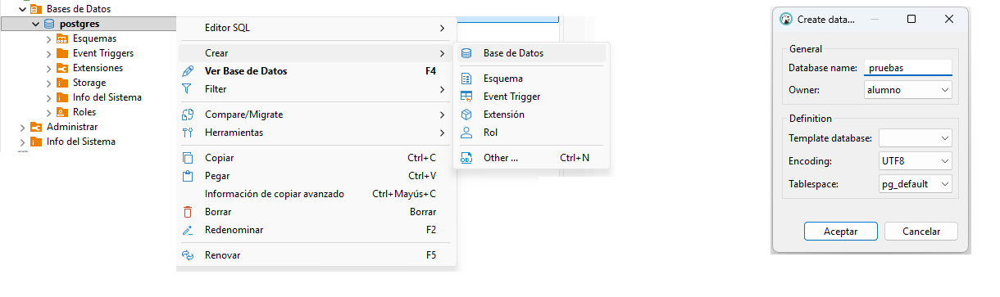
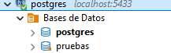
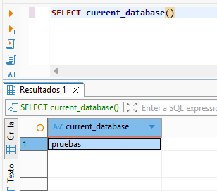

# 1. Introducción a DDL

Con **DDL** definirás la estructura de las bases de datos: tablas, columnas, claves y restricciones. Después, en **DML**, insertarás y modificarás los datos; finalmente, en **DQL**, los consultarás.

Antes de empezar, completa la preparación de [PostgreSQL con Docker Compose](../entorno_postgresql.md) y la [conexión con DBeaver](../2_client_dbeaver_installaci_i_confiuraci.md), disponibles en Inicio. Debes tener el servidor local funcionando y una conexión a `postgres`.

## Crear la base de pruebas y su conexión

Vamos a crear una base de datos llamada **pruebas** para realizar los ejemplos del tema y experimentar con las sentencias SQL. Así podremos crear, modificar y eliminar objetos sin afectar a las bases de datos **Moviles** y **Juegos**. También crearemos una conexión en DBeaver para trabajar directamente con ella.

La conexión inicial de Inicio apunta a `postgres`. Puedes crear la base de datos **con una sentencia SQL o en modo gráfico**. Elige una de las dos opciones; no es necesario hacer ambas.

### Opción 1: con una sentencia SQL

Desde la conexión a `postgres`, abre un editor SQL y ejecuta esta sentencia por separado:

```sql
CREATE DATABASE pruebas;
```


### Opción 2: en modo gráfico

1. En el navegador de DBeaver, despliega la conexión a PostgreSQL y localiza **Bases de datos / Databases**. Debes tener marcada la opción **Show all databases** en la configuración de la conexión.
2. Haz clic derecho sobre **Bases de datos / Databases** y selecciona **Crear → Base de datos / Create → Database**.
3. Escribe **pruebas** como nombre y deja **alumno** como propietario.
4. Confirma la creación y guarda los cambios si DBeaver lo solicita.
5. Actualiza el nodo **Bases de datos / Databases** para comprobar que aparece `pruebas`.



### Crear la conexión a pruebas

Crear la base de datos y crear una conexión son dos acciones distintas. **La base de datos `pruebas` se crea en el servidor PostgreSQL**; la conexión es la configuración que guarda **DBeaver** para acceder a ella.

La conexión inicial apunta a `postgres`, por lo que crear `pruebas` no cambia automáticamente la base de datos de ese editor SQL. Aunque puedas verla al activar **Show all databases**, conviene guardar una conexión específica a `pruebas`: así abrirás los ejemplos del tema directamente en la base correcta y evitarás crear sus tablas por error en `postgres`.

Esta nueva conexión no crea otra base de datos ni otro contenedor: utiliza el mismo servidor, cambiando únicamente la base de datos a la que accede.

Ahora crea una nueva conexión PostgreSQL en DBeaver:

| Campo | Valor |
| --- | --- |
| Host | `localhost` |
| Puerto | `5433` |
| Base de datos | `pruebas` |
| Usuario | `alumno` |
| Contraseña | `alumno` |

Abre un editor SQL desde esa conexión y ejecuta 
    `SELECT current_database();`
debe devolver `pruebas`. 

<div class="image-pair-grid" markdown>

<div class="image-panel" markdown>



</div>

<div class="image-panel" markdown>



</div>

</div>

Usa esta conexión para los ejemplos auxiliares de DDL.


