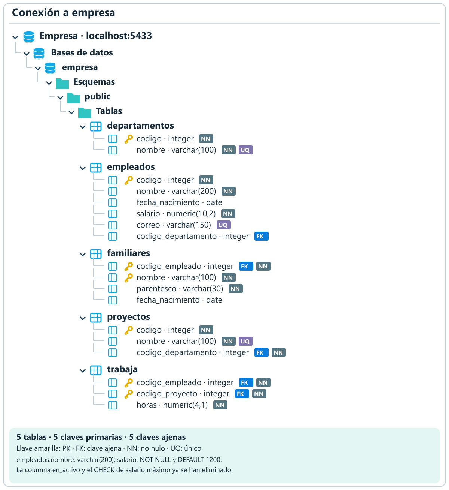
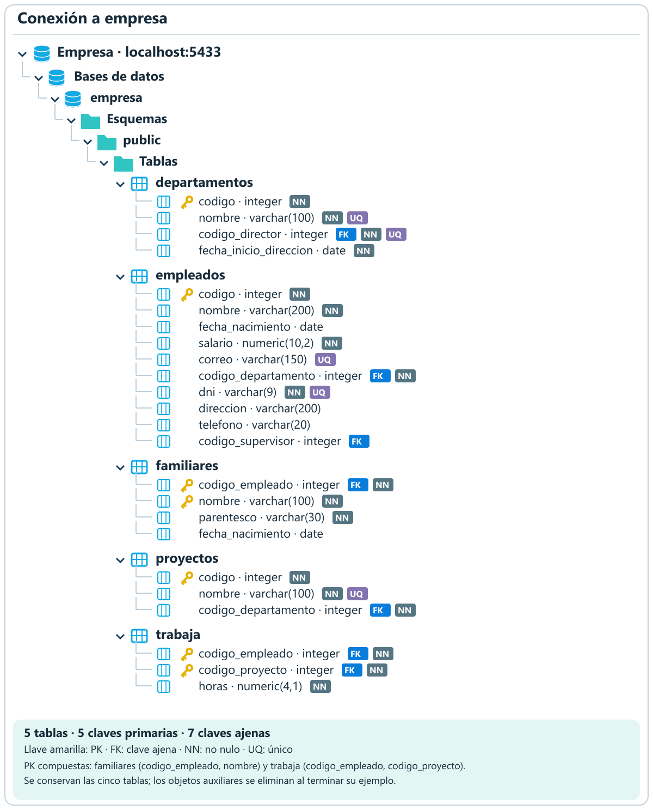
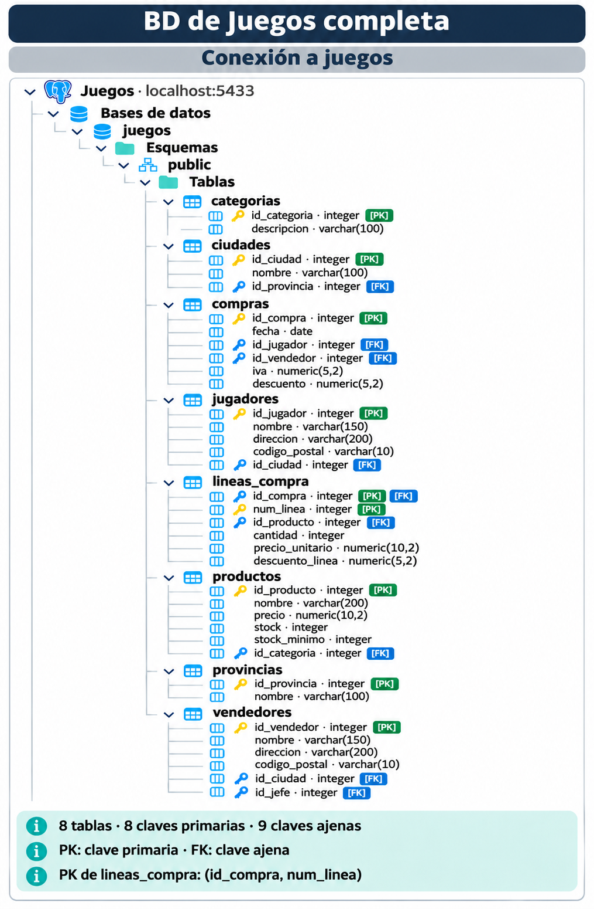

# ALTER TABLE

`ALTER TABLE` modifica la estructura de una tabla existente: permite añadir, eliminar o modificar columnas y restricciones.

!!! quote sintaxis "Sintaxis básica"

    <div class="syntax-table-wrap">
    <table class="syntax-table syntax-completa">
    <tbody>
    <tr><td><code>ALTER TABLE [<span class="ddl-table">esquema</span>.]<span class="ddl-table">tabla</span></code><br/><code>    { <span class="ddl-option">ADD</span> | <span class="ddl-option">DROP</span> | <span class="ddl-option">ALTER</span> }</code><br/><code>    { <span class="ddl-option">COLUMN</span> <span class="ddl-field">columna</span> | <span class="ddl-constraint">CONSTRAINT</span> <span class="ddl-constraint">restriccion_de_tabla</span> } ...;</code></td></tr>
    </tbody></table>
    </div>

    **Opciones**

    - <code><span class="ddl-option">ADD</span></code>: añade una columna o una restricción.
    - <code><span class="ddl-option">DROP</span></code>: elimina una columna o una restricción.
    - <code><span class="ddl-option">ALTER</span></code>: modifica una propiedad de una columna o, en los casos permitidos, de una restricción.
    - <code><span class="ddl-option">COLUMN</span></code>: actúa sobre una columna.
    - <code><span class="ddl-constraint">CONSTRAINT</span></code>: actúa sobre una restricción de tabla.
    - <code>...</code>: representa los detalles que necesita cada operación. Es un esquema general; no todas las combinaciones son válidas.

Antes de añadir una restricción, los datos existentes deben cumplirla. Para cambiar la definición de un `CHECK` o una clave ajena, se elimina la restricción y se crea de nuevo.

!!! example practica "Pruébalo: Modificar una tabla"

    Desde **empresa**, ejecuta las sentencias una a una y observa los cambios en `empleados`.

    ```sql
    ALTER TABLE empleados ADD COLUMN activo BOOLEAN DEFAULT TRUE;
    ALTER TABLE empleados ALTER COLUMN nombre TYPE VARCHAR(200);
    ALTER TABLE empleados ALTER COLUMN salario SET DEFAULT 1200;
    ALTER TABLE empleados ALTER COLUMN salario SET NOT NULL; -- Restricción de columna: NOT NULL
    ALTER TABLE empleados ADD CONSTRAINT ck_empleados_salario_maximo CHECK (salario <= 10000); -- Restricción de tabla: CHECK
    ALTER TABLE empleados RENAME COLUMN activo TO en_activo;
    ALTER TABLE empleados DROP COLUMN en_activo;
    ALTER TABLE empleados DROP CONSTRAINT ck_empleados_salario_maximo; -- Elimina la restricción de tabla CHECK
    ```


Actualiza la conexión **Empresa** y despliega las tablas. Esta imagen orientativa muestra el estado al terminar el ejemplo:

{ width="800" }

## Completar las relaciones de Empresa

Ya tenemos las cinco tablas. Ahora incorporaremos los datos personales que faltan, exigiremos que cada empleado pertenezca a un departamento y añadiremos el supervisor y el director de departamento, como en el modelo relacional. Ejecuta este bloque después del ejemplo anterior, mientras las tablas siguen vacías.

!!! example practica "Pruébalo: Completar Empresa con ALTER TABLE"

    Desde **empresa**, ejecuta en este orden:

    ```sql
    ALTER TABLE empleados ADD COLUMN dni VARCHAR(9) NOT NULL UNIQUE; -- Restricciones de columna: NOT NULL y UNIQUE
    ALTER TABLE empleados ADD COLUMN direccion VARCHAR(200);
    ALTER TABLE empleados ADD COLUMN telefono VARCHAR(20);
    ALTER TABLE empleados ALTER COLUMN codigo_departamento SET NOT NULL; -- Restricción de columna: NOT NULL
    ALTER TABLE empleados ADD COLUMN codigo_supervisor INTEGER;
    ALTER TABLE empleados ADD CONSTRAINT fk_empleados_supervisor -- Restricción de tabla: FOREIGN KEY reflexiva
        FOREIGN KEY (codigo_supervisor) REFERENCES empleados(codigo);

    ALTER TABLE departamentos ADD COLUMN codigo_director INTEGER NOT NULL UNIQUE; -- Restricciones de columna: NOT NULL y UNIQUE
    ALTER TABLE departamentos ADD COLUMN fecha_inicio_direccion DATE NOT NULL; -- Restricción de columna: NOT NULL
    ALTER TABLE departamentos ADD CONSTRAINT fk_departamentos_director -- Restricción de tabla: FOREIGN KEY
        FOREIGN KEY (codigo_director) REFERENCES empleados(codigo);
    ```

    El supervisor puede ser nulo. El director es obligatorio y único: cada departamento tiene un director y un empleado dirige como máximo un departamento. La fecha indica cuándo empezó a dirigirlo.

Departamentos y empleados se referencian mutuamente. Por eso hemos creado primero las tablas y añadido la FK del director al final. Al insertar datos en DML habrá que tener en cuenta esta dependencia: crear el departamento con su director y el empleado con su departamento requiere planificar la carga; no basta con elegir una tabla primero. Por ahora **conserva la estructura vacía**.

Actualiza la conexión **Empresa** y despliega las tablas. Esta imagen orientativa muestra el estado al terminar el ejemplo:

{ width="800" }


<a id="ejercicios-juegos"></a>

## Ejercicios: Completar la estructura

Continúa con las ocho tablas ya creadas. Ahora modificarás su estructura con `ALTER TABLE`, sin borrar las tablas ni repetir los CREATE.

### <span class="exercise-title"><span class="exercise-icon">📝</span><span>Ejercicio 9: Añadir alias</span></span> {#ejercicio-9-anadir-alias}

!!! ejercicio "Juegos"

    Añade a `vendedores` una columna `alias VARCHAR(40) NOT NULL UNIQUE`. La tabla todavía está vacía; explica qué habría que preparar si ya tuviera filas.

### <span class="exercise-title"><span class="exercise-icon">📝</span><span>Ejercicio 10: Eliminar alias</span></span> {#ejercicio-10-eliminar-alias}

!!! ejercicio "Juegos"

    Elimina la columna `alias`.

### <span class="exercise-title"><span class="exercise-icon">📝</span><span>Ejercicio 11: Añadir la PK de categorias</span></span> {#ejercicio-11-anadir-la-pk-de-categorias}

!!! ejercicio "Juegos"

    Desde la conexión **Juegos**, utiliza `ALTER TABLE` para añadir a `categorias` la clave primaria que dejamos pendiente en el ejercicio 1. No vuelvas a crear la tabla.

    **Modelo relacional que debe quedar**

    **CATEGORIAS** (<u>id_categoria</u>, descripcion)

    - PK: (id_categoria)

### <span class="exercise-title"><span class="exercise-icon">📝</span><span>Ejercicio 12: Completar productos y la relación reflexiva</span></span> {#ejercicio-12-completar-productos-y-la-relacion-reflexiva}

!!! ejercicio "Juegos"

    Desde la conexión **Juegos**, completa con `ALTER TABLE` las claves pendientes de `productos` y la relación reflexiva de `vendedores`. Conserva sus columnas y las restricciones que ya tienen.

    **Modelos relacionales que deben quedar**

    **PRODUCTOS** (<u>id_producto</u>, nombre, precio, stock, stock_minimo, <mark>id_categoria</mark>)

    - PK: (id_producto)
    - FK: id_categoria → CATEGORIAS(id_categoria)

    **VENDEDORES** (<u>id_vendedor</u>, nombre, direccion, codigo_postal, <mark>id_ciudad</mark>, <mark>id_jefe</mark>)

    - PK: (id_vendedor)
    - FK: id_ciudad → CIUDADES(id_ciudad)
    - FK: id_jefe → VENDEDORES(id_vendedor)

    Añade la PK de `productos` y su FK hacia `categorias`. En `vendedores`, añade únicamente la FK de `id_jefe` hacia `id_vendedor`; la PK y la FK de `id_ciudad` ya existen. `id_jefe` debe admitir nulos para los vendedores sin jefe.

### <span class="exercise-title"><span class="exercise-icon">📝</span><span>Ejercicio 13: Añadir las FK de lineas_compra</span></span> {#ejercicio-13-anadir-las-fk-de-lineas_compra}

!!! ejercicio "Juegos"

    Desde la conexión **Juegos**, utiliza `ALTER TABLE` para completar las dos claves ajenas de `lineas_compra`, pendientes desde el ejercicio 8. Conserva la PK compuesta y la obligatoriedad de `id_producto`.

    **Modelo relacional que debe quedar**

    **LINEAS_COMPRA** (<u><mark>id_compra</mark>, num_linea</u>, <mark>id_producto</mark>, cantidad, precio_unitario, descuento_linea)

    - PK: (id_compra, num_linea)
    - FK: id_compra → COMPRAS(id_compra)
    - FK: id_producto → PRODUCTOS(id_producto) <span class="tag-no-nulo">[no nulo]</span>

    Define la FK hacia `compras` con **ON DELETE CASCADE**, para que al borrar una compra se borren sus líneas. La FK hacia `productos` debe usar **NO ACTION**. Al terminar, comprueba que Juegos tiene ocho PK y nueve FK.

**Antes de continuar:** Comprueba que hay ocho PK y nueve FK. La columna temporal `alias` debe haber desaparecido. Conserva todas las tablas vacías para la carga de DML. Los ejercicios de índices y vistas se realizarán después, en DQL.

Al finalizar el ejercicio 13, actualiza la conexión **Juegos** y despliega las tablas y sus columnas. Esta imagen orientativa muestra la estructura completa, con las claves primarias y ajenas ya incorporadas. La PK de `lineas_compra` está formada por `id_compra` y `num_linea`:

{ width="800" }

