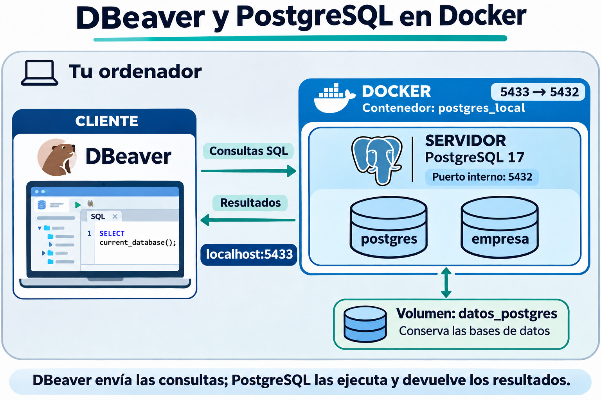
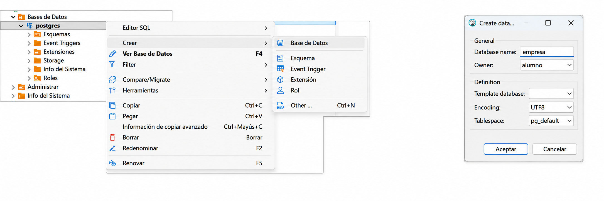
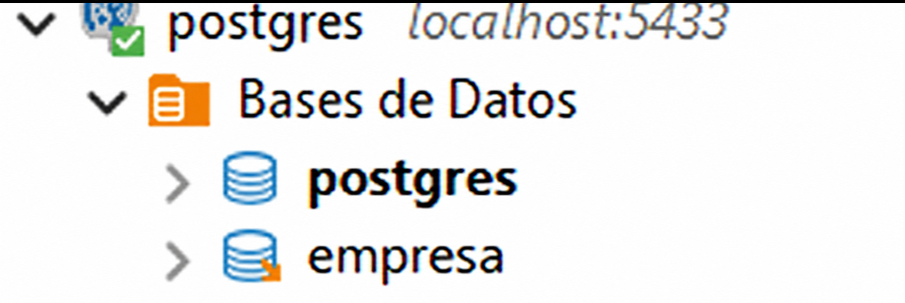
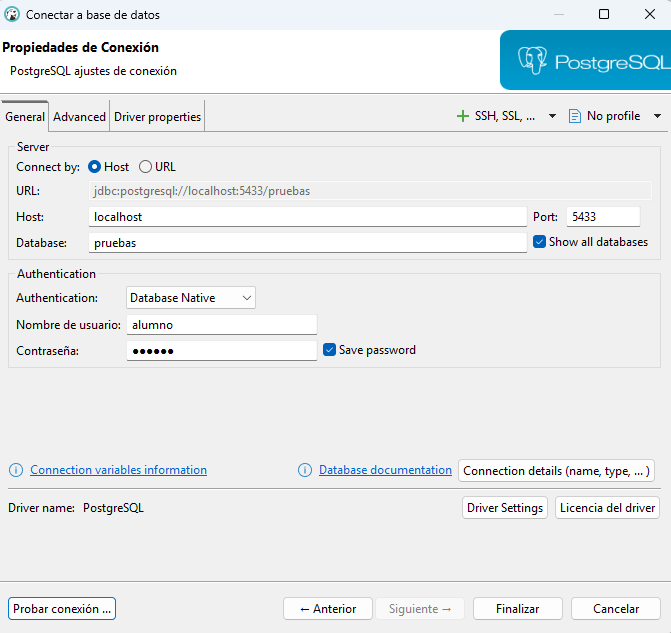
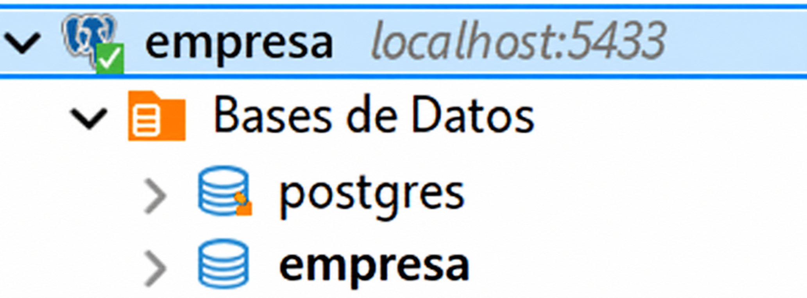
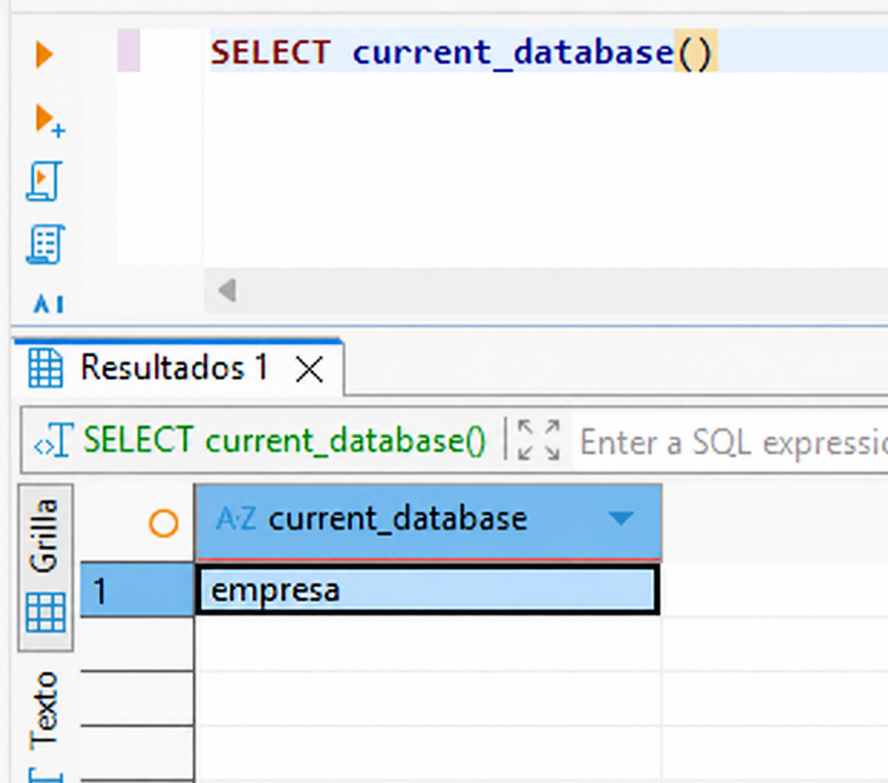

# Bases de Datos

Una **base de datos** contiene los esquemas y objetos con los que trabajaremos. `CREATE DATABASE` crea una base de datos nueva dentro del servidor PostgreSQL; después debemos conectarnos a ella para crear sus tablas.

!!! quote sintaxis "Sintaxis básica"

    <div class="syntax-table-wrap">
    <table class="syntax-table syntax-completa">
    <tbody>
    <tr><td><code>CREATE DATABASE <span class="ddl-table">nombre_bd</span></code><br/><code>    [ <span class="ddl-option">OWNER</span> <span class="ddl-table">nombre_usuario</span> ];</code></td></tr>
    </tbody></table>
    </div>

    **Opciones**

    - <code><span class="ddl-table">nombre_bd</span></code>: nombre de la nueva base de datos.
    - <code><span class="ddl-option">OWNER</span></code>: indica su propietario; si se omite, será el usuario que ejecuta la sentencia.


Primero crearemos **`empresa` y su conexión**, como ejemplo guiado. Después crearás **`juegos`**, como ejercicio 0. Ambas bases de datos estarán en el servidor PostgreSQL que preparamos en Inicio.

## Ejemplo guiado: Crear Empresa y su conexión {#crear-empresa}

Vamos a crear una base de datos llamada **`empresa` para los ejemplos guiados de los apuntes**. En ella construiremos progresivamente las tablas y relaciones de la BD Empresa, que ya vimos en el **modelo relacional**, a medida que expliquemos las sentencias de DDL. Después la utilizaremos también para otros ejemplos. Crearemos además una conexión en DBeaver para trabajar directamente con ella.

**Empresa** se utiliza para los ejemplos guiados; **Juegos**, para los ejercicios; y **Moviles**, para las consultas de DQL. Los objetos auxiliares de demostración se eliminarán al terminar cada ejemplo; conservaremos las tablas de Empresa.

La imagen muestra cómo quedará el entorno al crear `empresa`: estará junto a `postgres` en el mismo servidor PostgreSQL, dentro del contenedor que ya tenemos en marcha.



### Crear la base de datos Empresa {#crear-la-base-de-datos-empresa}

Vamos a crear `empresa` **dentro del servidor PostgreSQL que se ejecuta en nuestro contenedor Docker**. DBeaver será el cliente desde el que enviaremos la orden de creación.

La conexión inicial que configuramos en Inicio utiliza la base inicial `postgres` para acceder al servidor. Desde esa conexión crearemos otra base de datos, `empresa`, en el mismo servidor. **`postgres` y `empresa` serán dos bases de datos independientes, al mismo nivel**: `empresa` no se crea dentro de la base `postgres`, sino dentro del servidor PostgreSQL.

Puedes crearla **con una sentencia SQL o en modo gráfico**. Elige una de las dos opciones; no es necesario hacer ambas.

!!! note "Nombre de la base de datos"

    Utilizaremos minúsculas (`empresa`, `juegos`, `moviles`) y evitaremos espacios y tildes. En los títulos y en el nombre de la conexión de DBeaver podemos escribir **Empresa**: esa etiqueta no cambia el nombre real de la base de datos.

#### Opción 1: con una sentencia SQL

Desde la conexión a `postgres`, abre un editor SQL y ejecuta esta sentencia por separado:

```sql
CREATE DATABASE empresa;
```

Al ejecutar la sentencia desde la conexión a `postgres`, el usuario `alumno` será el propietario de la nueva base de datos, porque hemos omitido la opción `OWNER`.


#### Opción 2: en modo gráfico

1. En el navegador de DBeaver, despliega la conexión a PostgreSQL y localiza **Bases de datos / Databases**. Debes tener marcada la opción **Show all databases** en la configuración de la conexión.
2. Haz clic derecho sobre **Bases de datos / Databases** y selecciona **Crear → Base de datos / Create → Database**.
3. Escribe **empresa** como nombre y deja **alumno** como propietario.
4. Confirma la creación y guarda los cambios si DBeaver lo solicita.
5. Actualiza el nodo **Bases de datos / Databases** para comprobar que aparece `empresa`.



Después de crearla por cualquiera de las dos opciones, actualiza **Bases de datos / Databases**. Debe aparecer `empresa` junto a `postgres`:

{ width="300" }

### Crear la conexión a Empresa {#crear-la-conexion-a-empresa}

La base de datos **empresa ya está creada**. Ahora guardaremos en DBeaver una conexión que acceda directamente a ella. Utilizaremos el mismo servidor y usuario de antes; solo cambiaremos la base de datos de destino, de `postgres` a `empresa`.

La base `postgres` se utiliza como punto de acceso inicial al servidor. Para los ejemplos conviene utilizar `empresa`, donde podremos crear, modificar y eliminar tablas sin mezclar los ejercicios con esa base inicial. Cada editor SQL trabaja sobre una base de datos concreta: si lo abrimos desde la conexión a `postgres`, las tablas se crearán allí, aunque veamos `empresa` en el navegador.

Guardar una **conexión específica a empresa** facilita abrir los editores directamente en la base correcta y reconocer dónde estamos trabajando. No es obligatorio crear otra conexión para acceder a ella, pero sí es una forma más clara de organizar las prácticas y evitar errores. La conexión no crea otro servidor ni otra base de datos: solo guarda los datos de acceso a la que ya hemos creado.

<div class="connection-step" markdown>

#### Paso 1. Configurar una nueva conexión

En la barra de herramientas de DBeaver, abre **Nueva conexión → PostgreSQL** e introduce estos datos:

| Campo | Valor |
| --- | --- |
| Host | `localhost` |
| Puerto | `5433` |
| Base de datos | **`empresa`** |
| Usuario | `alumno` |
| Contraseña | `alumno` |

La ventana de conexión debe tener `empresa` en el campo **Database**:

{ .connection-capture }

Marca también **Show all databases** (Mostrar todas las bases de datos), que aparece en la ventana de conexión.

</div>

<div class="connection-step" markdown>

#### Paso 2. Probar y guardar

Pulsa **Probar conexión** y, si la prueba es correcta, **Finalizar**.

La nueva conexión aparecerá en el **Navegador de bases de datos**. Puedes renombrarla como **Empresa** para reconocerla fácilmente. Conserva también la conexión inicial a `postgres`.

{ width="300" }

</div>

<div class="connection-step" markdown>

#### Paso 3. Comprobar la base de datos del editor

Haz clic derecho sobre la **nueva conexión a empresa** y selecciona **Editor SQL → Nuevo script SQL**. Ejecuta esta consulta con **Ctrl + Intro**:

```sql
SELECT current_database();
```

El resultado debe ser **`empresa`**, como en esta captura:

{ width="350" }

Si el resultado es `postgres`, abre el editor desde la nueva conexión y revisa que su campo **Base de datos** sea `empresa`. Cambiar solo el nombre de la conexión no cambia su destino.

</div>

A partir de ahora, utiliza la conexión **Empresa** para realizar los **ejemplos guiados** de los apuntes. En DDL iremos construyendo sus tablas paso a paso.

Ahora crea **`juegos`** siguiendo los mismos pasos. Esta base se utilizará para los ejercicios: construiremos sus tablas y restricciones poco a poco en los siguientes apartados. **Empresa se utiliza para los ejemplos guiados; Juegos, para los ejercicios.**

## Ejercicios: Crear Juegos y su conexión {#crear-juegos-y-su-conexion}

**Sigue los mismos pasos que acabas de utilizar para crear `empresa` en el ejemplo guiado**, cambiando el nombre de la base de datos a `juegos`.

### <span class="exercise-title"><span class="exercise-icon">📝</span><span>Ejercicio 0: Preparar Juegos y su conexión</span></span> {#ejercicio-0-preparar-juegos-y-su-conexion}

!!! ejercicio "Juegos"

    1. Desde la conexión a **postgres**, abre **Editor SQL → Nuevo script SQL** y ejecuta:

        ```sql
        CREATE DATABASE juegos;
        ```

    2. Actualiza **Bases de datos / Databases** y comprueba que aparece `juegos`. También puedes crearla en modo gráfico, como explicamos al [crear empresa](crear_bases_datos.md#crear-la-base-de-datos-empresa): elige una de las dos opciones, no ambas.
    3. Crea una **nueva conexión PostgreSQL** siguiendo los [mismos pasos de la conexión a empresa](crear_bases_datos.md#crear-la-conexion-a-empresa). Mantén `localhost`, puerto `5433`, usuario y contraseña `alumno`, pero escribe **juegos** en el campo **Base de datos**. Guarda la conexión como **Juegos**.
    4. Abre un editor SQL desde esta nueva conexión y comprueba:

        ```sql
        SELECT current_database();
        ```

        El resultado debe ser **juegos**.

Si `juegos` ya existe, no vuelvas a crearla. Conserva esta conexión: la utilizarás para los ejercicios de construcción de Juegos. Los ejemplos de los recuadros **Pruébalo** de la teoría se realizan en `empresa`, salvo que indiquen otra base de datos, como en esta actividad.

Por ahora solo hemos creado la base de datos y su conexión. Empezaremos a crear sus tablas en los [ejercicios 1 y 2 de CREATE TABLE](tablas.md#ejercicios-juegos).
