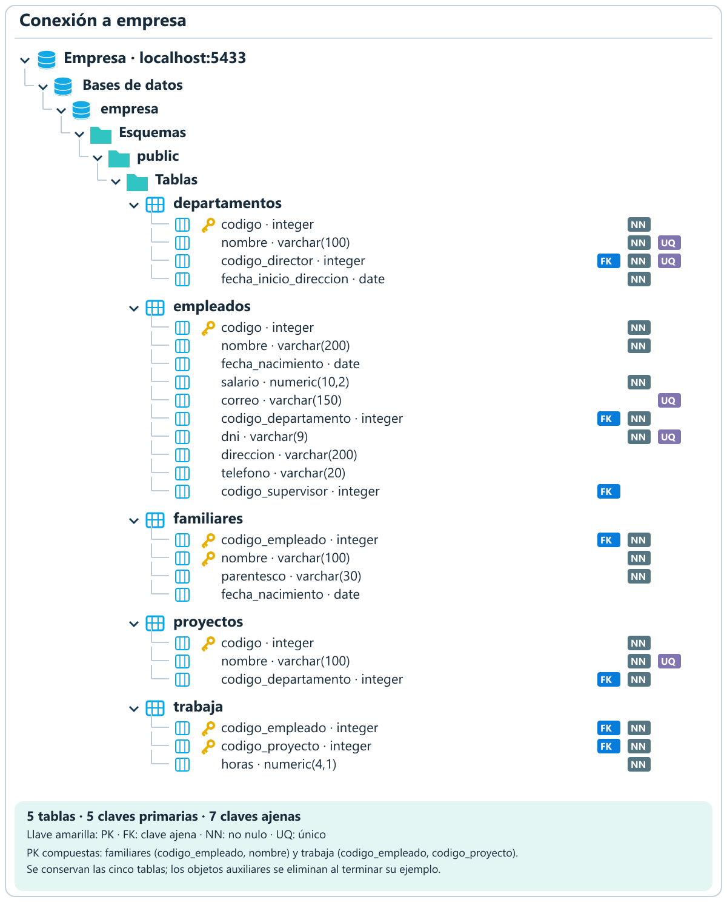

---
hide:
  - toc
---

# Dominios

Un dominio reutiliza un tipo de dato y sus restricciones en distintas columnas. `CREATE DOMAIN` lo define; `ALTER DOMAIN` cambia sus valores por defecto o sus restricciones, y `DROP DOMAIN` lo elimina, teniendo en cuenta los objetos que lo utilizan.

!!! quote sintaxis "Sintaxis básica"

    <div class="syntax-table-wrap">
    <table class="syntax-table syntax-completa">
    <tbody>
    <tr><td><code>CREATE DOMAIN [esquema.]nombre AS tipo_dato</code><br/><code>    [ DEFAULT expresion ]</code><br/><code>    [ NOT NULL ]</code><br/><code>    [ [ CONSTRAINT nombre_restriccion ] CHECK (condicion) ];</code></td></tr>
    <tr><td><code>ALTER DOMAIN [esquema.]nombre</code><br/><code>    { SET DEFAULT expresion</code><br/><code>    | DROP DEFAULT</code><br/><code>    | SET NOT NULL</code><br/><code>    | DROP NOT NULL</code><br/><code>    | ADD [ CONSTRAINT nombre ] CHECK (condicion)</code><br/><code>    | DROP CONSTRAINT nombre };</code></td></tr>
    <tr><td><code>DROP DOMAIN [ IF EXISTS ] [esquema.]nombre [, ...]</code><br/><code>    [ CASCADE | RESTRICT ];</code></td></tr>
    </tbody></table>
    </div>

    **Opciones**

    **`CREATE DOMAIN`**

    - `DEFAULT`: valor por defecto.
    - `NOT NULL`: exige un valor.
    - `CHECK`: comprueba una condición sobre `VALUE`.
    - `CONSTRAINT`: asigna un nombre a la restricción.

    **`ALTER DOMAIN`**

    - `SET / DROP`: establece o elimina el valor por defecto o la obligatoriedad.
    - `ADD / DROP CONSTRAINT`: añade o elimina restricciones.

    **`DROP DOMAIN`**

    - `IF EXISTS`: evita el error si no existe.
    - `RESTRICT`: impide borrar si hay dependencias (por defecto).
    - `CASCADE`: elimina también objetos dependientes.


En los CHECK de un dominio, `VALUE` representa el valor que se está validando. Los cambios deben ser compatibles con los datos de las columnas que ya lo utilizan.

!!! example practica "Pruébalo: Probar un dominio"

    Crea el dominio y la tabla que lo utiliza. Revisa sus definiciones antes de eliminar los objetos.

    ```sql
    CREATE DOMAIN porcentaje_demo AS NUMERIC(5,2)
        CHECK (VALUE BETWEEN 0 AND 100);
    CREATE TABLE promociones_demo (
        id_promocion SERIAL PRIMARY KEY,
        descuento porcentaje_demo NOT NULL
    );
    DROP TABLE promociones_demo;
    DROP DOMAIN porcentaje_demo;
    ```

Actualiza la conexión **Empresa** y despliega las tablas. Esta imagen orientativa muestra el estado al terminar el ejemplo:

{ width="800" }


La práctica que combina un dominio con un tipo enumerado se realizará en el [ejercicio 15 del apartado siguiente](tipos_enumerados.md#ejercicios-juegos). Conserva esa actividad para después de estudiar los tipos enumerados.
