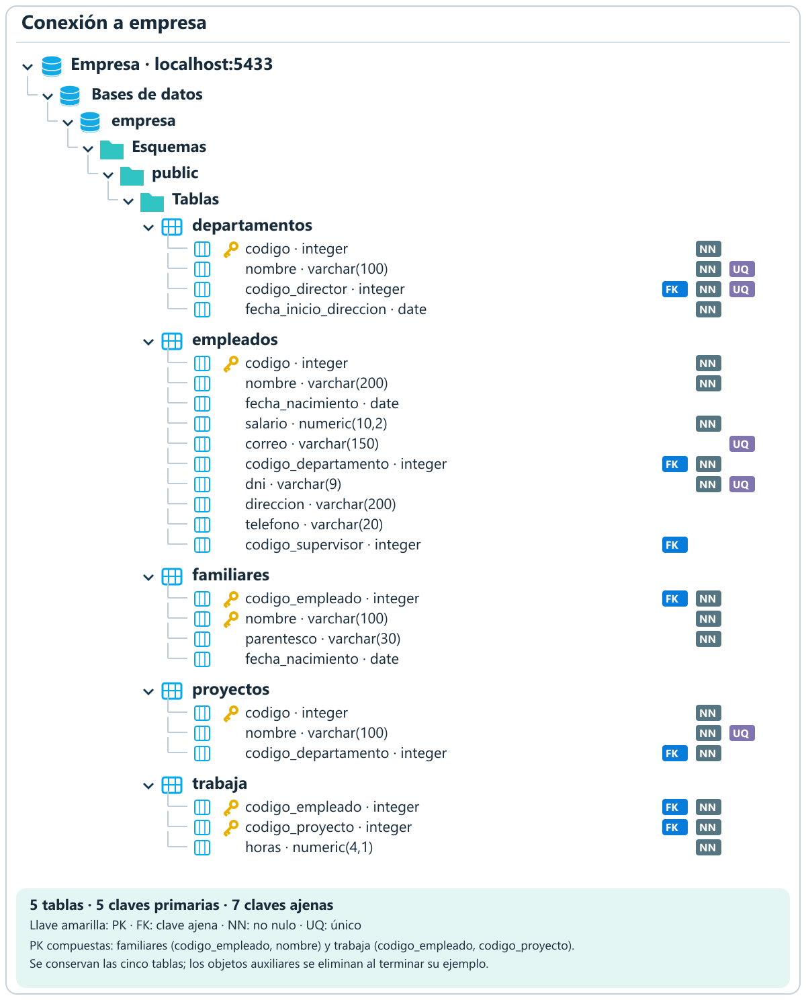

---
hide:
  - toc
---

# DROP TABLE

`DROP TABLE` elimina una tabla completa, incluida su estructura y todos sus datos. Las opciones `RESTRICT` y `CASCADE` determinan qué ocurre si otros objetos dependen de ella.

!!! quote sintaxis "Sintaxis básica"

    <div class="syntax-table-wrap">
    <table class="syntax-table syntax-completa">
    <tbody>
    <tr><td><code>DROP TABLE [ IF EXISTS ] [esquema.]nombre [, ...]</code><br/><code>    [ CASCADE | RESTRICT ];</code></td></tr>
    </tbody></table>
    </div>

    **Opciones**

    - `IF EXISTS`: evita el error si no existe.
    - `RESTRICT`: impide borrar si hay dependencias (por defecto).
    - `CASCADE`: elimina también objetos dependientes.


- `IF EXISTS`: si la tabla no existe, emite un aviso en lugar de un error.
- `RESTRICT`: comportamiento predeterminado; rechaza el borrado si hay objetos dependientes.
- `CASCADE`: elimina también objetos dependientes, como vistas o restricciones de clave ajena de otras tablas; no significa necesariamente borrar esas otras tablas.
- `[, ...]`: permite indicar varias tablas, separadas por comas.

!!! example practica "Pruébalo: Eliminar una tabla que ya no necesitamos"

    En **empresa**, crea una tabla auxiliar y elimínala. Conserva las cinco tablas de Empresa: `departamentos`, `empleados`, `proyectos`, `familiares` y `trabaja`.

    ```sql
    CREATE TABLE tabla_temporal_demo (
        codigo INTEGER,
        observacion VARCHAR(100)
    );

    DROP TABLE tabla_temporal_demo;
    ```

    Actualiza DBeaver y comprueba que solo ha desaparecido `tabla_temporal_demo`. Las tablas de Empresa se conservan para continuar trabajando con ellas.

Actualiza la conexión **Empresa** y despliega las tablas. Esta imagen orientativa muestra el estado al terminar el ejemplo:

{ width="800" }


Borra primero las tablas dependientes. `IF EXISTS` evita el error de objeto inexistente, pero no protege datos. `DROP TABLE ... CASCADE` elimina también objetos dependientes; no es equivalente a `ON DELETE CASCADE`, que actúa sobre filas. Usa `empresa` para estos ejemplos.
