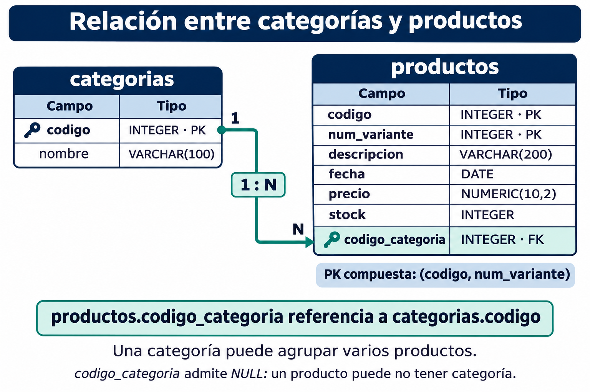

# Restricciones

Las restricciones definen las reglas que deben cumplir los datos de una tabla. En `CREATE TABLE` podemos declararlas sobre una columna o sobre varias columnas. Las claves ajenas permiten además mantener la coherencia entre tablas y representar la participación obligatoria en una relación.

#### Restricciones de una columna

Las restricciones de columna establecen las reglas que debe cumplir un campo: exigir un valor, evitar duplicados, identificar una fila o referenciar otra tabla. Se escriben después del tipo de dato y pueden recibir un nombre mediante `CONSTRAINT`.

!!! quote sintaxis "Sintaxis básica"

    <div class="syntax-table-wrap">
    <table class="syntax-table syntax-completa">
    <tbody>
    <tr><td><code>[ CONSTRAINT nombre ] { PRIMARY KEY | UNIQUE | NOT NULL | REFERENCES tabla2 [(columna1)] | CHECK (condicion) }</code></td></tr>
    </tbody></table>
    </div>

    **Opciones**

    - `CONSTRAINT`: asigna un nombre a la restricción.
    - `REFERENCES`: indica la clave referenciada.


- **PRIMARY KEY**: identifica la fila, sin duplicados ni nulos.
- **NOT NULL**: exige un valor.
- **UNIQUE**: impide duplicados; en su comportamiento normal permite varios nulos.
- **CHECK**: exige que una expresión no sea falsa. Si el resultado es desconocido por un NULL, la fila puede aceptarse; añade `NOT NULL` si el dato es obligatorio.
- **REFERENCES**: exige que el valor no nulo exista en una clave referenciada.

!!! example practica "Pruébalo: Restricciones de columna en categorias y productos"

    Desde la conexión a **pruebas**, vamos a recrear `categorias` y `productos` con restricciones. Como las tablas del apartado anterior están vacías, elimínalas primero; `DROP TABLE`, que estudiaremos más adelante, elimina su estructura.

    ```sql
    DROP TABLE productos;
    DROP TABLE categorias;

    CREATE TABLE categorias (
        codigo INTEGER PRIMARY KEY, -- Restricción de columna: PRIMARY KEY
        nombre VARCHAR(100) NOT NULL UNIQUE -- Restricciones de columna: NOT NULL y UNIQUE
    );

    CREATE TABLE productos (
        codigo INTEGER PRIMARY KEY, -- Restricción de columna: PRIMARY KEY
        descripcion VARCHAR(200) NOT NULL, -- Restricción de columna: NOT NULL
        fecha DATE,
        precio NUMERIC(10,2) CHECK (precio >= 0), -- Restricción de columna: CHECK
        stock INTEGER DEFAULT 0,
        codigo_categoria INTEGER REFERENCES categorias(codigo) -- Restricción de columna: REFERENCES
    );
    ```

    Crea primero `categorias`, porque `productos.codigo_categoria` referencia a su clave primaria. No borres estas tablas al terminar.

#### Restricciones de varias columnas

Las restricciones de tabla permiten definir claves que abarcan varias columnas y condiciones que relacionan distintos campos. Se incluyen dentro de `CREATE TABLE`, separadas de las definiciones de columna mediante comas.

!!! quote sintaxis "Sintaxis básica"

    <div class="syntax-table-wrap">
    <table class="syntax-table syntax-completa">
    <tbody>
    <tr><td><code>[ CONSTRAINT nombre ]</code><br/><code>{ { PRIMARY KEY | UNIQUE | FOREIGN KEY } (columna1 [, columna2, ...])</code><br/><code>    [ REFERENCES tabla2 [ (columna_ref1 [, columna_ref2, ...]) ] ]</code><br/><code>    [ ON DELETE { CASCADE | SET NULL } ] [ ON UPDATE { CASCADE | SET NULL } ]</code><br/><code>| CHECK (condicion) }</code></td></tr>
    </tbody></table>
    </div>

    **Opciones**

    - `CONSTRAINT`: asigna un nombre a la restricción.
    - `REFERENCES`: indica la tabla y las columnas referenciadas; se utiliza con `FOREIGN KEY`.
    - `ON DELETE / ON UPDATE`: acciones de la clave ajena al borrar o actualizar la fila referenciada. Si se omiten, se aplica `NO ACTION`.
    - `CHECK`: lleva su condición entre paréntesis, sin añadir otra lista de columnas.


En una FK compuesta, el número y los tipos de las columnas deben ser compatibles con los de la clave referenciada.

En este ejemplo añadiremos `num_variante` a `productos`. Su clave primaria estará formada por **dos columnas: `(codigo, num_variante)`**. Así podremos distinguir varias variantes de un mismo producto; lo que no podrá repetirse será la combinación de ambos valores.

{ width="800" }

!!! example practica "Pruébalo: Restricciones de tabla en productos"

    Conserva `categorias` y recrea únicamente `productos`, que sigue vacía. Ahora añade `num_variante` para distinguir variantes de un mismo producto y define las claves y comprobaciones como restricciones de tabla, separadas de las columnas.

    ```sql
    DROP TABLE productos;

    CREATE TABLE productos (
        codigo INTEGER,
        num_variante INTEGER,
        descripcion VARCHAR(200) NOT NULL, -- Restricción de columna: NOT NULL
        fecha DATE,
        precio NUMERIC(10,2),
        stock INTEGER DEFAULT 0,
        codigo_categoria INTEGER,
        CONSTRAINT pk_productos PRIMARY KEY (codigo, num_variante), -- Restricción de tabla: PRIMARY KEY compuesta
        CONSTRAINT uq_productos_descripcion UNIQUE (codigo_categoria, descripcion), -- Restricción de tabla: UNIQUE
        CONSTRAINT ck_productos_precio CHECK (precio >= 0), -- Restricción de tabla: CHECK
        CONSTRAINT fk_productos_categorias FOREIGN KEY (codigo_categoria) -- Restricción de tabla: FOREIGN KEY
            REFERENCES categorias(codigo)
    );
    ```

Un producto puede tener varias variantes, por ejemplo distintos colores. La pareja `(codigo, num_variante)` identifica cada variante: ninguno de sus campos admite nulos y la combinación no puede repetirse. `UNIQUE` impide repetir una descripción para un mismo `codigo_categoria` no nulo. Conserva ambas tablas para los siguientes ejemplos.

#### Claves ajenas y participación

Las acciones de `ON DELETE` y `ON UPDATE` son:

| Acción | Efecto sobre las filas que contienen la FK |
| --- | --- |
| `NO ACTION` | Rechaza la operación si al comprobar la restricción quedan referencias sin destino. Es la acción predeterminada. |
| `RESTRICT` | Impide la operación si hay referencias; esta comprobación no se puede aplazar. |
| `CASCADE` | Propaga el borrado o la actualización de la clave referenciada. |
| `SET NULL` | Asigna NULL a la referencia; requiere que las columnas afectadas admitan nulos. |
| `SET DEFAULT` | Aplica su valor por defecto, que debe seguir cumpliendo la FK. |

En las tablas que acabamos de crear en `pruebas`, `productos.codigo_categoria` referencia a `categorias.codigo`. Como admite nulos, una fila de `productos` puede no estar relacionada con ninguna fila de `categorias`: la clave ajena por sí sola no obliga a rellenarla. Si añadiéramos **NOT NULL** a esa columna, toda fila de `productos` tendría que referenciar una fila existente de `categorias`; así representaríamos su **participación total** en la relación.

En este ejemplo, se aplica `NO ACTION` por defecto: no podemos borrar una fila de `categorias` mientras haya filas de `productos` que la referencien. Si hubiéramos definido la FK con `ON DELETE CASCADE`, borrar esa fila de `categorias` también eliminaría sus filas relacionadas de `productos`. La acción debe elegirse según el comportamiento que necesitemos.


<a id="ejercicios-juegos"></a>

## Ejercicios: Crear tablas con restricciones

Continúa sobre la misma base de datos y conserva las tablas de los ejercicios 1 y 2. Añade las sentencias a `02_juegos.sql`. No es necesario volver a crear `categorias` ni `productos`.

### Ejercicio 3: Crear provincias

!!! ejercicio "Juegos"

    Crea `provincias` con sus dos campos y define `id_provincia` como clave primaria.

### Ejercicio 4: Crear ciudades

!!! ejercicio "Juegos"

    Crea `ciudades`. Define `id_ciudad` como clave primaria y `id_provincia` como clave ajena hacia `provincias(id_provincia)`.

### Ejercicio 5: Crear vendedores

!!! ejercicio "Juegos"

    Crea `vendedores` con su clave primaria y la clave ajena `id_ciudad` hacia `ciudades(id_ciudad)`. Incluye la columna `id_jefe`, pero **deja pendiente su clave ajena reflexiva** hasta el ejercicio 12.

### Ejercicio 6: Crear jugadores

!!! ejercicio "Juegos"

    Crea `jugadores` con su clave primaria y la clave ajena `id_ciudad` hacia `ciudades(id_ciudad)`.

### Ejercicio 7: Crear compras

!!! ejercicio "Juegos"

    Crea `compras` con su clave primaria y las claves ajenas hacia `jugadores` y `vendedores`. Define `id_jugador` e `id_vendedor` como **NOT NULL**: toda compra debe tener un jugador y un vendedor.

### Ejercicio 8: Crear lineas_compra

!!! ejercicio "Juegos"

    Crea `lineas_compra` con la clave primaria compuesta `(id_compra, num_linea)` y con `id_producto` obligatorio. **No añadas todavía ninguna de sus dos claves ajenas**: las incorporarás en el ejercicio 13. La PK compuesta debe declararse como restricción de tabla.

**Antes de continuar:** Debes tener ocho tablas, seis PK y cinco FK. Las PK de `categorias` y `productos`, la FK de `productos`, la relación reflexiva y las dos FK de `lineas_compra` siguen pendientes. Las completarás con ALTER TABLE.

