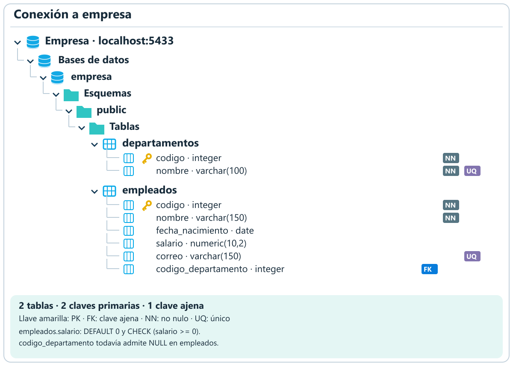
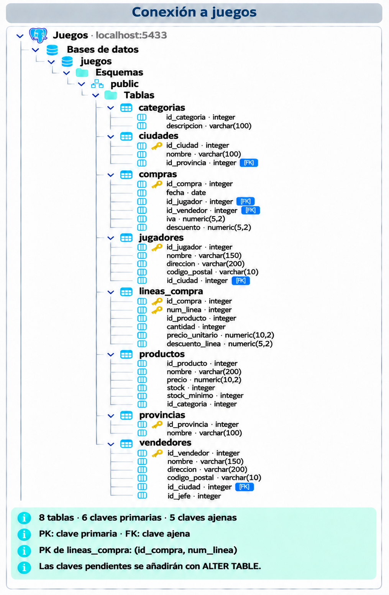

# Restricciones

Las restricciones definen las reglas que deben cumplir los datos de una tabla. En `CREATE TABLE` podemos declararlas sobre una columna o sobre varias columnas. Las claves ajenas permiten además mantener la coherencia entre tablas y representar la participación obligatoria en una relación.

## Restricciones de una columna

Las restricciones de columna establecen las reglas que debe cumplir un campo: exigir un valor, evitar duplicados, identificar una fila o referenciar otra tabla. Se escriben después del tipo de dato y pueden recibir un nombre mediante `CONSTRAINT`.

!!! quote sintaxis "Sintaxis básica"

    <div class="syntax-table-wrap">
    <table class="syntax-table syntax-completa">
    <tbody>
    <tr><td><code>[ CONSTRAINT nombre ] { PRIMARY KEY | UNIQUE | NOT NULL | REFERENCES tabla2 [(columna1)] | CHECK (condicion) }</code></td></tr>
    </tbody></table>
    </div>

    **Opciones**

    - `CONSTRAINT`: asigna un nombre a la restricción.
    - `REFERENCES`: indica la clave referenciada.


- **PRIMARY KEY**: identifica la fila, sin duplicados ni nulos.
- **NOT NULL**: exige un valor.
- **UNIQUE**: impide duplicados; en su comportamiento normal permite varios nulos.
- **CHECK**: exige que una expresión no sea falsa. Si el resultado es desconocido por un NULL, la fila puede aceptarse; añade `NOT NULL` si el dato es obligatorio.
- **REFERENCES**: exige que el valor no nulo exista en una clave referenciada.

!!! example practica "Pruébalo: Restricciones de columna en departamentos y empleados"

    Desde la conexión a **empresa**, recrea las dos tablas con restricciones. Como las tablas del apartado anterior están vacías, elimínalas primero; `DROP TABLE`, que estudiaremos más adelante, elimina su estructura.

    ```sql
    DROP TABLE empleados;
    DROP TABLE departamentos;

    CREATE TABLE departamentos (
        codigo INTEGER PRIMARY KEY, -- Restricción de columna: PRIMARY KEY
        nombre VARCHAR(100) NOT NULL UNIQUE -- Restricciones de columna: NOT NULL y UNIQUE
    );

    CREATE TABLE empleados (
        codigo INTEGER PRIMARY KEY, -- Restricción de columna: PRIMARY KEY
        nombre VARCHAR(150) NOT NULL, -- Restricción de columna: NOT NULL
        fecha_nacimiento DATE,
        salario NUMERIC(10,2) DEFAULT 0 CHECK (salario >= 0), -- Restricción de columna: CHECK
        correo VARCHAR(150) UNIQUE, -- Restricción de columna: UNIQUE
        codigo_departamento INTEGER REFERENCES departamentos(codigo) -- Restricción de columna: REFERENCES
    );
    ```

    Crea primero `departamentos`, porque `empleados.codigo_departamento` referencia a su clave primaria. Un departamento puede tener varios empleados. Conserva ambas tablas para los siguientes ejemplos.

Actualiza la conexión **Empresa** y despliega las tablas. Esta imagen orientativa muestra el estado al terminar el ejemplo:

{ width="800" }


### Incorporar los proyectos de Empresa

Un departamento controla varios proyectos y cada proyecto pertenece a un único departamento. Después de recrear las dos primeras tablas, añadimos la tercera tabla de Empresa.

!!! example practica "Pruébalo: Crear proyectos con restricciones de columna"

    En **empresa**, ejecuta:

    ```sql
    CREATE TABLE proyectos (
        codigo INTEGER PRIMARY KEY, -- Restricción de columna: PRIMARY KEY
        nombre VARCHAR(100) NOT NULL UNIQUE, -- Restricciones de columna: NOT NULL y UNIQUE
        codigo_departamento INTEGER NOT NULL REFERENCES departamentos(codigo) -- Restricciones de columna: NOT NULL y REFERENCES
    );
    ```

    Conserva `proyectos`: la utilizaremos al crear la relación N:M con empleados.

Actualiza la conexión **Empresa** y despliega las tablas. Esta imagen orientativa muestra el estado al terminar el ejemplo:

{ width="800" }


## Restricciones de varias columnas

Las restricciones de tabla permiten definir claves que abarcan varias columnas y condiciones que relacionan distintos campos. Se incluyen dentro de `CREATE TABLE`, separadas de las definiciones de columna mediante comas.

!!! quote sintaxis "Sintaxis básica"

    <div class="syntax-table-wrap">
    <table class="syntax-table syntax-completa">
    <tbody>
    <tr><td><code>[ CONSTRAINT nombre ]</code><br/><code>{ { PRIMARY KEY | UNIQUE | FOREIGN KEY } (columna1 [, columna2, ...])</code><br/><code>    [ REFERENCES tabla2 [ (columna_ref1 [, columna_ref2, ...]) ] ]</code><br/><code>    [ ON DELETE { CASCADE | SET NULL } ] [ ON UPDATE { CASCADE | SET NULL } ]</code><br/><code>| CHECK (condicion) }</code></td></tr>
    </tbody></table>
    </div>

    **Opciones**

    - `CONSTRAINT`: asigna un nombre a la restricción.
    - `REFERENCES`: indica la tabla y las columnas referenciadas; se utiliza con `FOREIGN KEY`.
    - `ON DELETE / ON UPDATE`: acciones de la clave ajena al borrar o actualizar la fila referenciada. Si se omiten, se aplica `NO ACTION`.
    - `CHECK`: lleva su condición entre paréntesis, sin añadir otra lista de columnas.


En una FK compuesta, el número y los tipos de las columnas deben ser compatibles con los de la clave referenciada.

Para practicar una **clave primaria compuesta**, crearemos una tabla nueva: **familiares**. Guardará los familiares de cada empleado. Conservaremos `departamentos` y `empleados` tal como están; **no añadiremos ninguna columna a empleados**.

La PK de `familiares` será **`(codigo_empleado, nombre)`**. Un empleado puede tener varios familiares y el mismo nombre puede aparecer para distintos empleados; lo que no podrá repetirse será la combinación de código de empleado y nombre del familiar.

{ width="800" }

!!! example practica "Pruébalo: Familiares de un empleado"

    Desde la conexión a **empresa**, crea `familiares` después de haber creado `empleados`:

    ```sql
    CREATE TABLE familiares (
        codigo_empleado INTEGER,
        nombre VARCHAR(100),
        parentesco VARCHAR(30) NOT NULL, -- Restricción de columna: NOT NULL
        fecha_nacimiento DATE,
        CONSTRAINT pk_familiares PRIMARY KEY (codigo_empleado, nombre), -- Restricción de tabla: PRIMARY KEY compuesta
        CONSTRAINT fk_familiares_empleados FOREIGN KEY (codigo_empleado) -- Restricción de tabla: FOREIGN KEY
            REFERENCES empleados(codigo),
        CONSTRAINT ck_familiares_parentesco -- Restricción de tabla: CHECK
            CHECK (parentesco IN ('hijo', 'hija', 'conyuge', 'otro'))
    );
    ```

La PK compuesta obliga a informar `codigo_empleado` y `nombre`, y evita que se repita la pareja. La FK exige que cada familiar pertenezca a un empleado existente. `CHECK` limita los valores de parentesco. Las restricciones de tabla se escriben separadas de las columnas, aunque algunas, como `CHECK`, solo afecten a un campo.

Actualiza la conexión **Empresa** y despliega las tablas. Esta imagen orientativa muestra el estado al terminar el ejemplo:

{ width="800" }


### Participación de empleados en proyectos

En el modelo relacional, la relación N:M se transforma en **`trabaja`**. Cada fila indica cuántas horas semanales dedica un empleado a un proyecto. La pareja empleado–proyecto no puede repetirse.

!!! example practica "Pruébalo: Crear la tabla trabaja"

    En **empresa**, conserva las tablas anteriores y ejecuta:

    ```sql
    CREATE TABLE trabaja (
        codigo_empleado INTEGER,
        codigo_proyecto INTEGER,
        horas NUMERIC(4,1) NOT NULL, -- Restricción de columna: NOT NULL
        CONSTRAINT pk_trabaja PRIMARY KEY (codigo_empleado, codigo_proyecto), -- Restricción de tabla: PRIMARY KEY compuesta
        CONSTRAINT fk_trabaja_empleados FOREIGN KEY (codigo_empleado) -- Restricción de tabla: FOREIGN KEY
            REFERENCES empleados(codigo),
        CONSTRAINT fk_trabaja_proyectos FOREIGN KEY (codigo_proyecto) -- Restricción de tabla: FOREIGN KEY
            REFERENCES proyectos(codigo),
        CONSTRAINT ck_trabaja_horas CHECK (horas > 0 AND horas <= 40) -- Restricción de tabla: CHECK
    );
    ```

    Actualiza DBeaver: ya deben aparecer `departamentos`, `empleados`, `proyectos`, `familiares` y `trabaja`. Conserva las cinco tablas.

La PK compuesta hace obligatorios ambos códigos y las FK garantizan que existan el empleado y el proyecto. La regla del modelo «todo proyecto tiene al menos un empleado» **no queda garantizada solo con estas claves**; requiere un control adicional que no implementaremos en estos ejemplos.

Actualiza la conexión **Empresa** y despliega las tablas. Esta imagen orientativa muestra el estado al terminar el ejemplo:

{ width="800" }


## Claves ajenas y participación

Las acciones de `ON DELETE` y `ON UPDATE` son:

| Acción | Efecto sobre las filas que contienen la FK |
| --- | --- |
| `NO ACTION` | Rechaza la operación si al comprobar la restricción quedan referencias sin destino. Es la acción predeterminada. |
| `RESTRICT` | Impide la operación si hay referencias; esta comprobación no se puede aplazar. |
| `CASCADE` | Propaga el borrado o la actualización de la clave referenciada. |
| `SET NULL` | Asigna NULL a la referencia; requiere que las columnas afectadas admitan nulos. |
| `SET DEFAULT` | Aplica su valor por defecto, que debe seguir cumpliendo la FK. |

En las tablas de `empresa`, `empleados.codigo_departamento` referencia a `departamentos.codigo`. Como admite nulos, un empleado puede estar sin departamento: la clave ajena por sí sola no obliga a rellenarla. Si añadiéramos **NOT NULL** a esa columna, todo empleado tendría que pertenecer a un departamento existente; así representaríamos su **participación total** en la relación.

En `familiares`, en cambio, `codigo_empleado` ya es obligatorio porque forma parte de la PK compuesta: todo familiar debe pertenecer a un empleado existente.

Se aplica `NO ACTION` por defecto: no podemos borrar un departamento mientras haya empleados que lo referencien. Si hubiéramos definido esa FK con `ON DELETE CASCADE`, borrar el departamento también intentaría borrar sus empleados; otras referencias, como las de `familiares`, podrían impedirlo. La acción debe elegirse teniendo en cuenta todas las relaciones.


<a id="ejercicios-juegos"></a>

## Ejercicios: Crear tablas con restricciones

Continúa sobre la misma base de datos y conserva las tablas de los ejercicios 1 y 2. Añade las sentencias a `02_juegos.sql`. No es necesario volver a crear `categorias` ni `productos`.

### <span class="exercise-title"><span class="exercise-icon">📝</span><span>Ejercicio 3: Crear provincias</span></span> {#ejercicio-3-crear-provincias}

!!! ejercicio "Juegos"

    **Campos de `provincias`**

    | Campo | Tipo de dato |
    | --- | --- |
    | `id_provincia` | `SERIAL` |
    | `nombre` | `VARCHAR(100)` |

    Crea `provincias` con sus dos campos y define `id_provincia` como clave primaria.

### <span class="exercise-title"><span class="exercise-icon">📝</span><span>Ejercicio 4: Crear ciudades</span></span> {#ejercicio-4-crear-ciudades}

!!! ejercicio "Juegos"

    **Campos de `ciudades`**

    | Campo | Tipo de dato |
    | --- | --- |
    | `id_ciudad` | `SERIAL` |
    | `nombre` | `VARCHAR(100)` |
    | `id_provincia` | `INTEGER` |

    Crea `ciudades`. Define `id_ciudad` como clave primaria y `id_provincia` como clave ajena hacia `provincias(id_provincia)`.

### <span class="exercise-title"><span class="exercise-icon">📝</span><span>Ejercicio 5: Crear vendedores</span></span> {#ejercicio-5-crear-vendedores}

!!! ejercicio "Juegos"

    **Campos de `vendedores`**

    | Campo | Tipo de dato |
    | --- | --- |
    | `id_vendedor` | `SERIAL` |
    | `nombre` | `VARCHAR(150)` |
    | `direccion` | `VARCHAR(200)` |
    | `codigo_postal` | `VARCHAR(10)` |
    | `id_ciudad` | `INTEGER` |
    | `id_jefe` | `INTEGER` |

    Crea `vendedores` con su clave primaria y la clave ajena `id_ciudad` hacia `ciudades(id_ciudad)`. Incluye la columna `id_jefe`, pero **deja pendiente su clave ajena reflexiva** hasta el ejercicio 12.

### <span class="exercise-title"><span class="exercise-icon">📝</span><span>Ejercicio 6: Crear jugadores</span></span> {#ejercicio-6-crear-jugadores}

!!! ejercicio "Juegos"

    **Campos de `jugadores`**

    | Campo | Tipo de dato |
    | --- | --- |
    | `id_jugador` | `SERIAL` |
    | `nombre` | `VARCHAR(150)` |
    | `direccion` | `VARCHAR(200)` |
    | `codigo_postal` | `VARCHAR(10)` |
    | `id_ciudad` | `INTEGER` |

    Crea `jugadores` con su clave primaria y la clave ajena `id_ciudad` hacia `ciudades(id_ciudad)`.

### <span class="exercise-title"><span class="exercise-icon">📝</span><span>Ejercicio 7: Crear compras</span></span> {#ejercicio-7-crear-compras}

!!! ejercicio "Juegos"

    **Campos de `compras`**

    | Campo | Tipo de dato |
    | --- | --- |
    | `id_compra` | `SERIAL` |
    | `fecha` | `DATE` |
    | `id_jugador` | `INTEGER` |
    | `id_vendedor` | `INTEGER` |
    | `iva` | `DECIMAL(5,2)` |
    | `descuento` | `DECIMAL(5,2)` |

    Crea `compras` con su clave primaria y las claves ajenas hacia `jugadores` y `vendedores`. Define `id_jugador` e `id_vendedor` como **NOT NULL**: toda compra debe tener un jugador y un vendedor.

### <span class="exercise-title"><span class="exercise-icon">📝</span><span>Ejercicio 8: Crear lineas_compra</span></span> {#ejercicio-8-crear-lineas_compra}

!!! ejercicio "Juegos"

    **Campos de `lineas_compra`**

    | Campo | Tipo de dato |
    | --- | --- |
    | `id_compra` | `INTEGER` |
    | `num_linea` | `INTEGER` |
    | `id_producto` | `INTEGER` |
    | `cantidad` | `INTEGER` |
    | `precio_unitario` | `DECIMAL(10,2)` |
    | `descuento_linea` | `DECIMAL(5,2)` |

    Crea `lineas_compra` con la clave primaria compuesta `(id_compra, num_linea)` y con `id_producto` obligatorio. **No añadas todavía ninguna de sus dos claves ajenas**: las incorporarás en el ejercicio 13. La PK compuesta debe declararse como restricción de tabla.

**Antes de continuar:** Debes tener ocho tablas, seis PK y cinco FK. Las PK de `categorias` y `productos`, la FK de `productos`, la relación reflexiva y las dos FK de `lineas_compra` siguen pendientes. Las completarás con ALTER TABLE.

Actualiza la conexión **Juegos** y despliega **Bases de datos → juegos → Esquemas → public → Tablas**. Después del ejercicio 8 deben aparecer las ocho tablas, como en esta imagen orientativa. Todas están desplegadas para comprobar sus columnas y tipos de datos:

{ width="800" }

