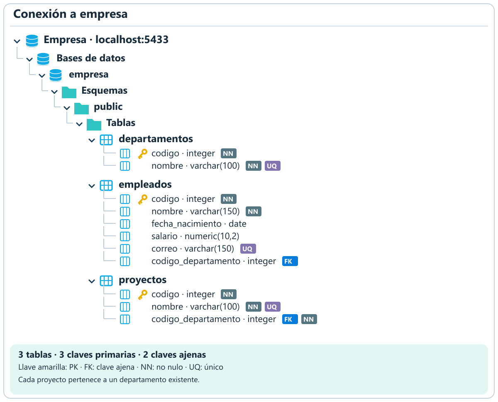
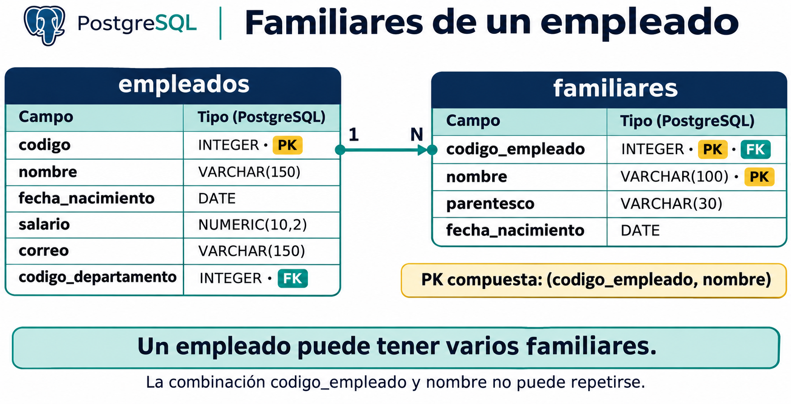
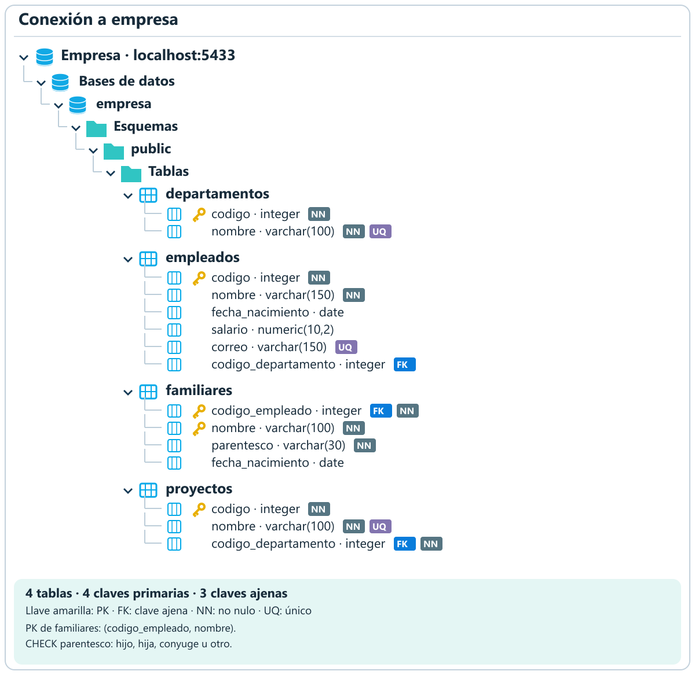
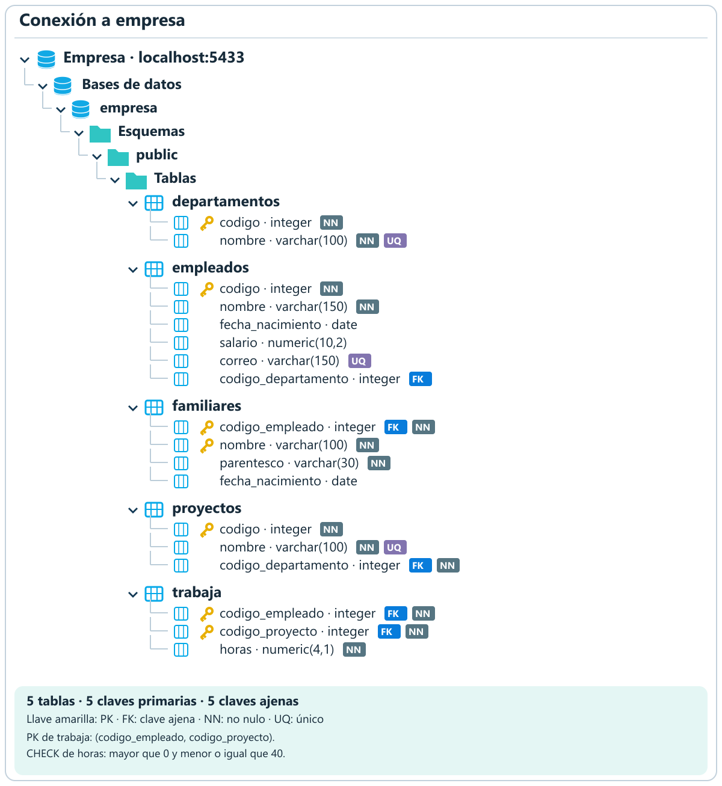

# Restricciones

Las restricciones definen las reglas que deben cumplir los datos de una tabla. En `CREATE TABLE` podemos declararlas sobre una columna o sobre varias columnas. Las claves ajenas permiten además mantener la coherencia entre tablas y representar la participación obligatoria en una relación.

## Restricciones de una columna

Las restricciones de columna establecen las reglas que debe cumplir un campo: exigir un valor, evitar duplicados, identificar una fila o referenciar otra tabla. Se escriben después del tipo de dato y pueden recibir un nombre mediante `CONSTRAINT`.

!!! quote sintaxis "Sintaxis básica"

    <div class="syntax-table-wrap">
    <table class="syntax-table syntax-completa">
    <tbody>
    <tr><td><code>[ <span class="ddl-constraint">CONSTRAINT</span> <span class="ddl-constraint">nombre</span> ]</code><br><code>{ <span class="ddl-constraint">PRIMARY KEY</span> | <span class="ddl-constraint">UNIQUE</span> | <span class="ddl-constraint">NOT NULL</span> | <span class="ddl-constraint">CHECK</span> (<span class="ddl-constraint">condicion</span>) | <span class="ddl-constraint">REFERENCES</span> <span class="ddl-table">tabla2</span> [(<span class="ddl-field">columna1</span>)] </code><br><code>    [ <span class="ddl-constraint">ON DELETE</span> { <span class="ddl-option">CASCADE</span> | <span class="ddl-option">SET NULL</span> | <span class="ddl-option">SET DEFAULT</span> | <span class="ddl-option">RESTRICT</span> | <span class="ddl-option">NO ACTION</span> } ]</code><br><code>    [ <span class="ddl-constraint">ON UPDATE</span> { <span class="ddl-option">CASCADE</span> | <span class="ddl-option">SET NULL</span> | <span class="ddl-option">SET DEFAULT</span> | <span class="ddl-option">RESTRICT</span> | <span class="ddl-option">NO ACTION</span> } ] }</code></td></tr>
    </tbody></table>
    </div>

    **Opciones**

    - <code><span class="ddl-constraint">CONSTRAINT</span></code>: asigna un nombre a la restricción.
    - <code><span class="ddl-constraint">PRIMARY KEY</span></code>: identifica la fila, sin duplicados ni nulos.
    - <code><span class="ddl-constraint">UNIQUE</span></code>: impide duplicados; en su comportamiento normal permite varios nulos.
    - <code><span class="ddl-constraint">NOT NULL</span></code>: exige un valor.
    - <code><span class="ddl-constraint">CHECK</span></code>: exige que una expresión no sea falsa. Si el resultado es desconocido por un NULL, la fila puede aceptarse; añade <code><span class="ddl-constraint">NOT NULL</span></code> si el dato es obligatorio.
    - <code><span class="ddl-constraint">REFERENCES</span></code>: indica la clave referenciada y exige que el valor no nulo exista en ella.

    **Acciones de la clave ajena**

    Las cláusulas <code><span class="ddl-constraint">ON DELETE</span></code> y <code><span class="ddl-constraint">ON UPDATE</span></code> se aplican únicamente a <code><span class="ddl-constraint">REFERENCES</span></code>: indican qué hacer con las filas que contienen la clave ajena cuando se borra la fila referenciada o se modifica su clave.

    - <code><span class="ddl-option">CASCADE</span></code>: al borrar, elimina también las filas que la referencian; al actualizar la clave referenciada, actualiza los valores de sus claves ajenas.
    - <code><span class="ddl-option">SET NULL</span></code>: pone la clave ajena a NULL; sus columnas deben admitir nulos.
    - <code><span class="ddl-option">SET DEFAULT</span></code>: asigna el valor por defecto; este debe seguir cumpliendo la clave ajena.
    - <code><span class="ddl-option">RESTRICT</span></code>: impide la operación si existen filas que la referencian; su comprobación no se puede aplazar.
    - <code><span class="ddl-option">NO ACTION</span></code>: rechaza la operación si al comprobar la restricción quedan referencias sin destino. Es la acción predeterminada cuando se omite la cláusula.

!!! example practica "Pruébalo: Restricciones de columna en departamentos y empleados"

    Desde la conexión a **empresa**, recrea las dos tablas con restricciones. Como las tablas del apartado anterior están vacías, elimínalas primero; `DROP TABLE`, que estudiaremos más adelante, elimina su estructura.

    ```sql
    DROP TABLE empleados;
    DROP TABLE departamentos;

    CREATE TABLE departamentos (
        codigo INTEGER PRIMARY KEY, -- Restricción de columna: PRIMARY KEY
        nombre VARCHAR(100) NOT NULL UNIQUE -- Restricciones de columna: NOT NULL y UNIQUE
    );

    CREATE TABLE empleados (
        codigo INTEGER PRIMARY KEY, -- Restricción de columna: PRIMARY KEY
        nombre VARCHAR(150) NOT NULL, -- Restricción de columna: NOT NULL
        fecha_nacimiento DATE,
        salario NUMERIC(10,2) DEFAULT 0 CHECK (salario >= 0), -- Restricción de columna: CHECK
        correo VARCHAR(150) UNIQUE, -- Restricción de columna: UNIQUE
        codigo_departamento INTEGER REFERENCES departamentos(codigo) -- Restricción de columna: REFERENCES
    );
    ```

    Crea primero `departamentos`, porque `empleados.codigo_departamento` referencia a su clave primaria. Un departamento puede tener varios empleados. Conserva ambas tablas para los siguientes ejemplos.

Actualiza la conexión **Empresa** y despliega las tablas. Esta imagen orientativa muestra el estado al terminar el ejemplo:

{ width="800" }


### Incorporar los proyectos de Empresa

Un departamento controla varios proyectos y cada proyecto pertenece a un único departamento. Después de recrear las dos primeras tablas, añadimos la tercera tabla de Empresa.

!!! example practica "Pruébalo: Crear proyectos con restricciones de columna"

    En **empresa**, ejecuta:

    ```sql
    CREATE TABLE proyectos (
        codigo INTEGER PRIMARY KEY, -- Restricción de columna: PRIMARY KEY
        nombre VARCHAR(100) NOT NULL UNIQUE, -- Restricciones de columna: NOT NULL y UNIQUE
        codigo_departamento INTEGER NOT NULL REFERENCES departamentos(codigo) -- Restricciones de columna: NOT NULL y REFERENCES
    );
    ```

    Conserva `proyectos`: la utilizaremos al crear la relación N:M con empleados.

Actualiza la conexión **Empresa** y despliega las tablas. Esta imagen orientativa muestra el estado al terminar el ejemplo:

{ width="800" }


## Restricciones de varias columnas

Las restricciones de tabla permiten definir claves que abarcan varias columnas y condiciones que relacionan distintos campos. Se incluyen dentro de `CREATE TABLE`, separadas de las definiciones de columna mediante comas.

!!! note "¿Cuándo es obligatorio utilizar una restricción de tabla?"

    Cuando una **PRIMARY KEY**, **UNIQUE** o **FOREIGN KEY** afecta a **varias columnas**, hay que declararla como restricción de tabla. Así la regla se aplica a la combinación de campos:

    - `PRIMARY KEY (codigo_empleado, nombre)`: identifica cada familiar mediante la combinación de empleado y nombre.
    - `UNIQUE (codigo_departamento, nombre)`: impide repetir la pareja, aunque cada valor por separado pueda repetirse.
    - `FOREIGN KEY (campo1, campo2) REFERENCES otra_tabla (clave1, clave2)`: referencia una clave formada por dos columnas.

    Para un **CHECK que compara varias columnas**, también lo declararemos a nivel de tabla, por ejemplo: `CHECK (stock >= stock_minimo)`. PostgreSQL permite escribirlo en una columna, pero la forma de tabla expresa mejor que la condición relaciona varios campos.

    Si la regla afecta a una sola columna, normalmente puede declararse en esa columna o a nivel de tabla, salvo `NOT NULL`, que en PostgreSQL 17 debe declararse en la columna.

!!! quote sintaxis "Sintaxis básica"

    <div class="syntax-table-wrap">
    <table class="syntax-table syntax-completa">
    <tbody>
    <tr><td><code>[ <span class="ddl-constraint">CONSTRAINT</span> <span class="ddl-constraint">nombre</span> ]</code><br/><code>{ { <span class="ddl-constraint">PRIMARY KEY</span> | <span class="ddl-constraint">UNIQUE</span> | <span class="ddl-constraint">FOREIGN KEY</span> } (<span class="ddl-field">columna1</span> [, <span class="ddl-field">columna2</span>, ...])</code><br/><code>    [ <span class="ddl-constraint">REFERENCES</span> <span class="ddl-table">tabla2</span> [ (<span class="ddl-field">columna_ref1</span> [, <span class="ddl-field">columna_ref2</span>, ...]) ] ]</code><br/><code>    [ <span class="ddl-constraint">ON DELETE</span> { <span class="ddl-option">CASCADE</span> | <span class="ddl-option">SET NULL</span> | <span class="ddl-option">SET DEFAULT</span> | <span class="ddl-option">RESTRICT</span> | <span class="ddl-option">NO ACTION</span> } ]</code><br/><code>    [ <span class="ddl-constraint">ON UPDATE</span> { <span class="ddl-option">CASCADE</span> | <span class="ddl-option">SET NULL</span> | <span class="ddl-option">SET DEFAULT</span> | <span class="ddl-option">RESTRICT</span> | <span class="ddl-option">NO ACTION</span> } ]</code><br/><code>| <span class="ddl-constraint">CHECK</span> (<span class="ddl-constraint">condicion</span>) }</code></td></tr>
    </tbody></table>
    </div>

    **Opciones**

    - <code><span class="ddl-constraint">CONSTRAINT</span></code>: asigna un nombre a la restricción.
    - <code><span class="ddl-constraint">REFERENCES</span></code>: indica la tabla y las columnas referenciadas; se utiliza con <code><span class="ddl-constraint">FOREIGN KEY</span></code>.
    - <code><span class="ddl-constraint">ON DELETE</span> / <span class="ddl-constraint">ON UPDATE</span></code>: acciones de la clave ajena al borrar o actualizar la fila referenciada. Si se omiten, se aplica <code>NO ACTION</code>.
    - <code><span class="ddl-constraint">CHECK</span></code>: lleva su condición entre paréntesis, sin añadir otra lista de columnas.


!!! warning "NOT NULL se declara en la columna"

    En **PostgreSQL 17**, `NOT NULL` no se puede declarar como restricción de tabla. Debe escribirse en la definición de cada columna que sea obligatoria, por ejemplo: `nombre VARCHAR(100) NOT NULL`.

    No utilices `NOT NULL (nombre)` como una restricción separada al final de `CREATE TABLE`.


**La misma tabla con restricciones de columna y de tabla**

Las dos definiciones siguientes crean `empleados` con las mismas reglas que en el ejemplo anterior. En la izquierda, las restricciones se escriben junto a cada columna; en la derecha, la PK, el UNIQUE, el CHECK y la FK se declaran al final de la tabla.

<div class="ddl-compare-wrap">
<table class="ddl-compare">
<thead><tr><th>Restricciones de columna</th><th>Restricciones de tabla</th></tr></thead>
<tbody><tr><td><pre><code>CREATE TABLE <span class="ddl-table">empleados</span> (
    <span class="ddl-field">codigo</span> <span class="ddl-type">INTEGER</span> <span class="ddl-constraint">PRIMARY KEY</span>,
    <span class="ddl-field">nombre</span> <span class="ddl-type">VARCHAR(150)</span> <span class="ddl-constraint">NOT NULL</span>,
    <span class="ddl-field">fecha_nacimiento</span> <span class="ddl-type">DATE</span>,
    <span class="ddl-field">salario</span> <span class="ddl-type">NUMERIC(10,2)</span> <span class="ddl-default">DEFAULT 0</span>
        <span class="ddl-constraint">CHECK</span> (<span class="ddl-field">salario</span> &gt;= 0),
    <span class="ddl-field">correo</span> <span class="ddl-type">VARCHAR(150)</span> <span class="ddl-constraint">UNIQUE</span>,
    <span class="ddl-field">codigo_departamento</span> <span class="ddl-type">INTEGER</span>
        <span class="ddl-constraint">REFERENCES</span> <span class="ddl-table">departamentos</span>(<span class="ddl-field">codigo</span>)
);</code></pre></td><td><pre><code>CREATE TABLE <span class="ddl-table">empleados</span> (
    <span class="ddl-field">codigo</span> <span class="ddl-type">INTEGER</span>,
    <span class="ddl-field">nombre</span> <span class="ddl-type">VARCHAR(150)</span> <span class="ddl-constraint">NOT NULL</span>,
    <span class="ddl-field">fecha_nacimiento</span> <span class="ddl-type">DATE</span>,
    <span class="ddl-field">salario</span> <span class="ddl-type">NUMERIC(10,2)</span> <span class="ddl-default">DEFAULT 0</span>,
    <span class="ddl-field">correo</span> <span class="ddl-type">VARCHAR(150)</span>,
    <span class="ddl-field">codigo_departamento</span> <span class="ddl-type">INTEGER</span>,
    <span class="ddl-constraint">PRIMARY KEY</span> (<span class="ddl-field">codigo</span>),
    <span class="ddl-constraint">CHECK</span> (<span class="ddl-field">salario</span> &gt;= 0),
    <span class="ddl-constraint">UNIQUE</span> (<span class="ddl-field">correo</span>),
    <span class="ddl-constraint">FOREIGN KEY</span> (<span class="ddl-field">codigo_departamento</span>)
        <span class="ddl-constraint">REFERENCES</span> <span class="ddl-table">departamentos</span>(<span class="ddl-field">codigo</span>)
);</code></pre></td></tr></tbody>
</table>
</div>

En ambas versiones, **`NOT NULL` permanece en la definición de `nombre`** y `DEFAULT` junto a `salario`. La FK exige que exista previamente `departamentos` con su clave primaria.

Esta comparación es una referencia: **no vuelvas a crear `empleados` si ya existe**. Conserva las tablas que has construido y continúa con el ejemplo de Familiares.

Para practicar una **clave primaria compuesta**, crearemos una tabla nueva: **familiares**. Guardará los familiares de cada empleado. Conservaremos `departamentos` y `empleados` tal como están; **no añadiremos ninguna columna a empleados**.

La PK de `familiares` será **`(codigo_empleado, nombre)`**. Un empleado puede tener varios familiares y el mismo nombre puede aparecer para distintos empleados; lo que no podrá repetirse será la combinación de código de empleado y nombre del familiar.

{ width="800" }

!!! example practica "Pruébalo: Familiares de un empleado"

    Desde la conexión a **empresa**, crea `familiares` después de haber creado `empleados`:

    ```sql
    CREATE TABLE familiares (
        codigo_empleado INTEGER,
        nombre VARCHAR(100),
        parentesco VARCHAR(30) NOT NULL, -- Restricción de columna: NOT NULL
        fecha_nacimiento DATE,
        CONSTRAINT pk_familiares PRIMARY KEY (codigo_empleado, nombre), -- Restricción de tabla: PRIMARY KEY compuesta
        CONSTRAINT fk_familiares_empleados FOREIGN KEY (codigo_empleado) -- Restricción de tabla: FOREIGN KEY
            REFERENCES empleados(codigo),
        CONSTRAINT ck_familiares_parentesco -- Restricción de tabla: CHECK
            CHECK (parentesco IN ('hijo', 'hija', 'conyuge', 'otro'))
    );
    ```

La PK compuesta obliga a informar `codigo_empleado` y `nombre`, y evita que se repita la pareja. La FK exige que cada familiar pertenezca a un empleado existente. `CHECK` limita los valores de parentesco. Las restricciones de tabla se escriben separadas de las columnas, aunque algunas, como `CHECK`, solo afecten a un campo.

Actualiza la conexión **Empresa** y despliega las tablas. Esta imagen orientativa muestra el estado al terminar el ejemplo:

{ width="800" }


### Participación de empleados en proyectos

En el modelo relacional, la relación N:M se transforma en **`trabaja`**. Cada fila indica cuántas horas semanales dedica un empleado a un proyecto. La pareja empleado–proyecto no puede repetirse.

!!! example practica "Pruébalo: Crear la tabla trabaja"

    En **empresa**, conserva las tablas anteriores y ejecuta:

    ```sql
    CREATE TABLE trabaja (
        codigo_empleado INTEGER,
        codigo_proyecto INTEGER,
        horas NUMERIC(4,1) NOT NULL, -- Restricción de columna: NOT NULL
        CONSTRAINT pk_trabaja PRIMARY KEY (codigo_empleado, codigo_proyecto), -- Restricción de tabla: PRIMARY KEY compuesta
        CONSTRAINT fk_trabaja_empleados FOREIGN KEY (codigo_empleado) -- Restricción de tabla: FOREIGN KEY
            REFERENCES empleados(codigo),
        CONSTRAINT fk_trabaja_proyectos FOREIGN KEY (codigo_proyecto) -- Restricción de tabla: FOREIGN KEY
            REFERENCES proyectos(codigo),
        CONSTRAINT ck_trabaja_horas CHECK (horas > 0 AND horas <= 40) -- Restricción de tabla: CHECK
    );
    ```

    Actualiza DBeaver: ya deben aparecer `departamentos`, `empleados`, `proyectos`, `familiares` y `trabaja`. Conserva las cinco tablas.

La PK compuesta hace obligatorios ambos códigos y las FK garantizan que existan el empleado y el proyecto. La regla del modelo «todo proyecto tiene al menos un empleado» **no queda garantizada solo con estas claves**; requiere un control adicional que no implementaremos en estos ejemplos.

Actualiza la conexión **Empresa** y despliega las tablas. Esta imagen orientativa muestra el estado al terminar el ejemplo:

{ width="800" }


<a id="ejercicios-juegos"></a>

## Ejercicios: Crear tablas con restricciones

Continúa sobre la misma base de datos y conserva las tablas de los ejercicios 1 y 2. Añade las sentencias a `juegos.sql`. No es necesario volver a crear `categorias` ni `productos`.

### <span class="exercise-title"><span class="exercise-icon">📝</span><span>Ejercicio 3: Crear provincias</span></span> {#ejercicio-3-crear-provincias}

!!! ejercicio "Juegos"

    Desde la conexión **Juegos**, crea `provincias` para registrar las provincias de las ciudades. Utiliza los campos y tipos de la tabla siguiente y define `id_provincia` como clave primaria.

    **Modelo relacional**

    **PROVINCIAS** (<u>id_provincia</u>, nombre)

    - PK: (id_provincia)

    **Campos de `provincias`**

    | Campo | Tipo de dato |
    | --- | --- |
    | `id_provincia` | `SERIAL` |
    | `nombre` | `VARCHAR(100)` |

### <span class="exercise-title"><span class="exercise-icon">📝</span><span>Ejercicio 4: Crear ciudades</span></span> {#ejercicio-4-crear-ciudades}

!!! ejercicio "Juegos"

    Desde la conexión **Juegos**, crea `ciudades` para registrar las ciudades y la provincia a la que pertenece cada una. Define su clave primaria y la clave ajena hacia `provincias`, que ya debe existir.

    **Modelo relacional**

    **CIUDADES** (<u>id_ciudad</u>, nombre, <mark>id_provincia</mark>)

    - PK: (id_ciudad)
    - FK: id_provincia → PROVINCIAS(id_provincia)

    **Campos de `ciudades`**

    | Campo | Tipo de dato |
    | --- | --- |
    | `id_ciudad` | `SERIAL` |
    | `nombre` | `VARCHAR(100)` |
    | `id_provincia` | `INTEGER` |

### <span class="exercise-title"><span class="exercise-icon">📝</span><span>Ejercicio 5: Crear vendedores</span></span> {#ejercicio-5-crear-vendedores}

!!! ejercicio "Juegos"

    Desde la conexión **Juegos**, crea `vendedores` para guardar los datos de los vendedores y la ciudad a la que están asociados. Define la clave primaria y la clave ajena hacia `ciudades`.

    **Modelo relacional**

    **VENDEDORES** (<u>id_vendedor</u>, nombre, direccion, codigo_postal, <mark>id_ciudad</mark>, <mark>id_jefe</mark>)

    - PK: (id_vendedor)
    - FK: id_ciudad → CIUDADES(id_ciudad)
    - FK: id_jefe → VENDEDORES(id_vendedor)

    El modelo incluye la relación reflexiva con el jefe. Añade la columna `id_jefe`, pero **deja pendiente su FK hasta el ejercicio 12**. Por ahora solo debes crear la FK de `id_ciudad`.

    **Campos de `vendedores`**

    | Campo | Tipo de dato |
    | --- | --- |
    | `id_vendedor` | `SERIAL` |
    | `nombre` | `VARCHAR(150)` |
    | `direccion` | `VARCHAR(200)` |
    | `codigo_postal` | `VARCHAR(10)` |
    | `id_ciudad` | `INTEGER` |
    | `id_jefe` | `INTEGER` |

### <span class="exercise-title"><span class="exercise-icon">📝</span><span>Ejercicio 6: Crear jugadores</span></span> {#ejercicio-6-crear-jugadores}

!!! ejercicio "Juegos"

    Desde la conexión **Juegos**, crea `jugadores` para guardar los datos de los clientes de la tienda. Define la clave primaria y la clave ajena hacia `ciudades`, siguiendo el modelo y los tipos indicados.

    **Modelo relacional**

    **JUGADORES** (<u>id_jugador</u>, nombre, direccion, codigo_postal, <mark>id_ciudad</mark>)

    - PK: (id_jugador)
    - FK: id_ciudad → CIUDADES(id_ciudad)

    **Campos de `jugadores`**

    | Campo | Tipo de dato |
    | --- | --- |
    | `id_jugador` | `SERIAL` |
    | `nombre` | `VARCHAR(150)` |
    | `direccion` | `VARCHAR(200)` |
    | `codigo_postal` | `VARCHAR(10)` |
    | `id_ciudad` | `INTEGER` |

### <span class="exercise-title"><span class="exercise-icon">📝</span><span>Ejercicio 7: Crear compras</span></span> {#ejercicio-7-crear-compras}

!!! ejercicio "Juegos"

    Desde la conexión **Juegos**, crea `compras` para registrar la fecha, el jugador que compra y el vendedor que lo atiende, junto con el IVA y el descuento. Define la clave primaria y las dos claves ajenas del modelo.

    **Modelo relacional**

    **COMPRAS** (<u>id_compra</u>, fecha, <mark>id_jugador</mark>, <mark>id_vendedor</mark>, iva, descuento)

    - PK: (id_compra)
    - FK: id_jugador → JUGADORES(id_jugador) <span class="tag-no-nulo">[no nulo]</span>
    - FK: id_vendedor → VENDEDORES(id_vendedor) <span class="tag-no-nulo">[no nulo]</span>

    Define `id_jugador` e `id_vendedor` como **NOT NULL**: toda compra debe estar asociada a un jugador y a un vendedor existentes.

    **Campos de `compras`**

    | Campo | Tipo de dato |
    | --- | --- |
    | `id_compra` | `SERIAL` |
    | `fecha` | `DATE` |
    | `id_jugador` | `INTEGER` |
    | `id_vendedor` | `INTEGER` |
    | `iva` | `DECIMAL(5,2)` |
    | `descuento` | `DECIMAL(5,2)` |

### <span class="exercise-title"><span class="exercise-icon">📝</span><span>Ejercicio 8: Crear lineas_compra</span></span> {#ejercicio-8-crear-lineas_compra}

!!! ejercicio "Juegos"

    Desde la conexión **Juegos**, crea `lineas_compra` para detallar los productos de cada compra, sus cantidades, precios y descuentos. Una compra puede tener varias líneas, identificadas por su número dentro de esa compra.

    **Modelo relacional**

    **LINEAS_COMPRA** (<u><mark>id_compra</mark>, num_linea</u>, <mark>id_producto</mark>, cantidad, precio_unitario, descuento_linea)

    - PK: (id_compra, num_linea)
    - FK: id_compra → COMPRAS(id_compra)
    - FK: id_producto → PRODUCTOS(id_producto) <span class="tag-no-nulo">[no nulo]</span>

    Declara la PK compuesta `(id_compra, num_linea)` como **restricción de tabla** y exige un valor en `id_producto`. El modelo muestra también las dos FK, pero **no las añadas todavía**: las incorporaremos en el ejercicio 13. No añadas otro código autonumérico.

    **Campos de `lineas_compra`**

    | Campo | Tipo de dato |
    | --- | --- |
    | `id_compra` | `INTEGER` |
    | `num_linea` | `INTEGER` |
    | `id_producto` | `INTEGER` |
    | `cantidad` | `INTEGER` |
    | `precio_unitario` | `DECIMAL(10,2)` |
    | `descuento_linea` | `DECIMAL(5,2)` |

**Antes de continuar:** Debes tener ocho tablas, seis PK y cinco FK. Las PK de `categorias` y `productos`, la FK de `productos`, la relación reflexiva y las dos FK de `lineas_compra` siguen pendientes. Las completarás con ALTER TABLE.

Actualiza la conexión **Juegos** y despliega **Bases de datos → juegos → Esquemas → public → Tablas**. Después del ejercicio 8 deben aparecer las ocho tablas, como en esta imagen orientativa. Todas están desplegadas para comprobar sus columnas y tipos de datos:

{ width="800" }

