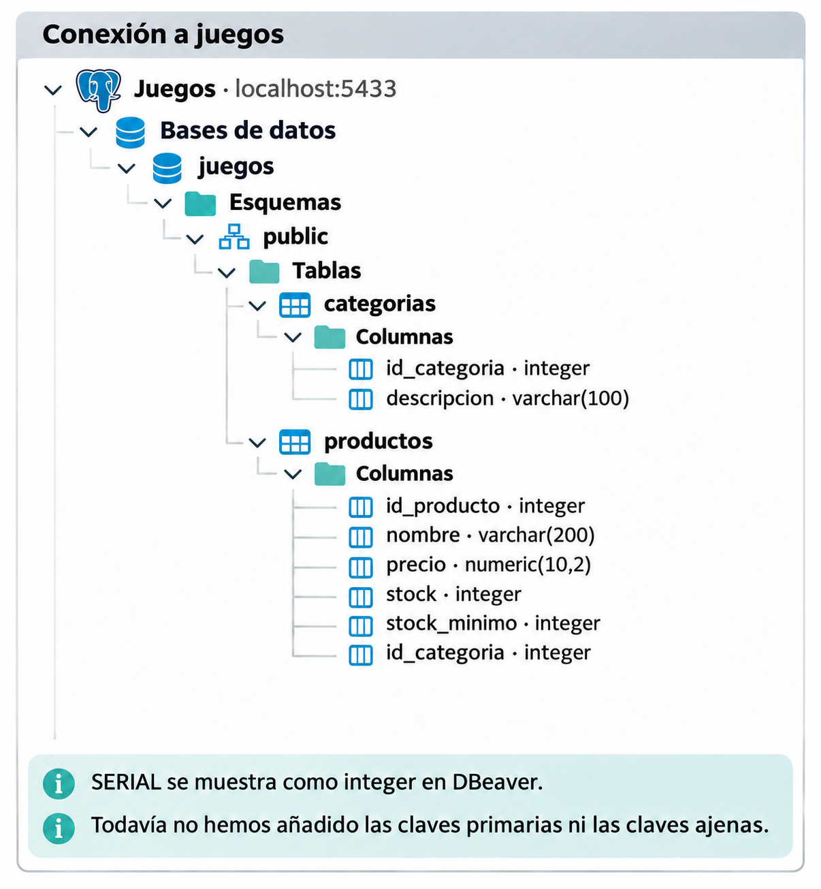

# CREATE TABLE

`CREATE TABLE` crea una tabla y define sus columnas, tipos de datos, valores por defecto y restricciones. La tabla se crea vacía, preparada para insertar datos más adelante.

!!! quote sintaxis "Sintaxis básica"

    <div class="syntax-table-wrap">
    <table class="syntax-table syntax-completa">
    <tbody>
    <tr><td><code>CREATE TABLE [ IF NOT EXISTS ] [esquema.]nombre_tabla (</code><br><code>    columna tipo_dato [ DEFAULT expresion ] [ restricciones_de_columna ]</code><br><code>    [, ...]</code><br><code>    [, restricciones_de_tabla ... ]</code><br><code>);</code></td></tr>
    </tbody></table>
    </div>

    **Opciones**

    - `IF NOT EXISTS`: evita el error si la tabla ya existe; no modifica su estructura.
    - `esquema.`: opcional; si se omite, en estas prácticas se utiliza `public` por defecto.
    - `DEFAULT`: valor que se aplica si se omite la columna.
    - `restricciones_de_columna`: reglas como `NOT NULL`, `PRIMARY KEY`, `UNIQUE`, `CHECK` o `REFERENCES`.
    - `restricciones_de_tabla`: reglas sobre una o varias columnas, separadas de las definiciones de columna mediante comas.

Las columnas se separan por comas. Usa identificadores sin espacios, acentos ni comillas.

A continuación, para practicar la creación de tablas, crearemos **categorias** y **productos** dentro de la base de datos **pruebas**. Este esquema muestra la estructura que iremos construyendo: empezaremos con tablas sin restricciones y, en el siguiente apartado, incorporaremos las claves y las reglas de validación.

{ width="800" }

!!! example practica "Pruébalo: Crear tablas sin restricciones"

    Desde la conexión a **pruebas**, ejecuta estas sentencias y comprueba que aparecen `categorias` y `productos` en el navegador de DBeaver. Una categoría permitirá agrupar productos; por ahora solo definimos los nombres y tipos de las columnas, sin añadir restricciones. Estas tablas de ejemplo pertenecen a `pruebas` y son independientes de las que construiremos en `juegos`.

    ```sql
    CREATE TABLE categorias (
        codigo INTEGER,
        nombre VARCHAR(100)
    );

    CREATE TABLE productos (
        codigo INTEGER,
        descripcion VARCHAR(200),
        fecha DATE,
        precio NUMERIC(10,2)
    );
    ```

    Las dos tablas están vacías y todavía no tienen claves primarias, claves ajenas ni otras restricciones. Conserva ambas: en el siguiente apartado las recrearemos para incorporar restricciones.

<a id="ejercicios-juegos"></a>

## Ejercicios: Crear las primeras tablas

Antes de empezar, completa [la creación de Juegos y su conexión](crear_bases_datos.md#crear-juegos-y-su-conexion). Los campos y tipos necesarios aparecen en cada ejercicio. Guarda las sentencias en `02_juegos.sql`.

??? info "Referencia general de campos y tipos de Juegos"

    | Tabla | Campos y tipos |
    | --- | --- |
    | categorias | id_categoria SERIAL, descripcion VARCHAR(100). |
    | productos | id_producto SERIAL, nombre VARCHAR(200), precio DECIMAL(10,2), stock INTEGER, stock_minimo INTEGER, id_categoria INTEGER. |
    | provincias | id_provincia SERIAL, nombre VARCHAR(100). |
    | ciudades | id_ciudad SERIAL, nombre VARCHAR(100), id_provincia INTEGER. |
    | vendedores | id_vendedor SERIAL, nombre VARCHAR(150), direccion VARCHAR(200), codigo_postal VARCHAR(10), id_ciudad INTEGER, id_jefe INTEGER. |
    | jugadores | id_jugador SERIAL, nombre VARCHAR(150), direccion VARCHAR(200), codigo_postal VARCHAR(10), id_ciudad INTEGER. |
    | compras | id_compra SERIAL, fecha DATE, id_jugador INTEGER, id_vendedor INTEGER, iva DECIMAL(5,2), descuento DECIMAL(5,2). |
    | lineas_compra | id_compra INTEGER, num_linea INTEGER, id_producto INTEGER, cantidad INTEGER, precio_unitario DECIMAL(10,2), descuento_linea DECIMAL(5,2). |

    Recuerda:

    - `SERIAL` genera códigos, pero no añade una PK por sí solo. Para las claves ajenas utiliza `INTEGER`.
    - La PK de `lineas_compra` será `(id_compra, num_linea)`; no añadas otro código autonumérico.
    - `vendedores.id_jefe` puede ser nulo y referencia a la propia tabla. Añadirás esa FK en el ejercicio 12.
    - La FK de las líneas hacia las compras llevará `ON DELETE CASCADE`; las demás referencias conservarán `NO ACTION`, como indica el ejercicio 13.
    - Después de cada ejercicio, actualiza el navegador de DBeaver y revisa las columnas y restricciones que hayas añadido.

### <span class="exercise-title"><span class="exercise-icon">📝</span><span>Ejercicio 1: Crear categorias</span></span> {#ejercicio-1-crear-categorias}

!!! ejercicio "Juegos"

    **Campos de `categorias`**

    | Campo | Tipo de dato |
    | --- | --- |
    | `id_categoria` | `SERIAL` |
    | `descripcion` | `VARCHAR(100)` |

    Crea `categorias` con los campos y tipos indicados arriba. Utiliza `SERIAL` en `id_categoria`, pero no añadas todavía la clave primaria ni otras restricciones explícitas.

### <span class="exercise-title"><span class="exercise-icon">📝</span><span>Ejercicio 2: Crear productos</span></span> {#ejercicio-2-crear-productos}

!!! ejercicio "Juegos"

    **Campos de `productos`**

    | Campo | Tipo de dato |
    | --- | --- |
    | `id_producto` | `SERIAL` |
    | `nombre` | `VARCHAR(200)` |
    | `precio` | `DECIMAL(10,2)` |
    | `stock` | `INTEGER` |
    | `stock_minimo` | `INTEGER` |
    | `id_categoria` | `INTEGER` |

    Crea `productos` con todos sus campos. Utiliza `SERIAL` en `id_producto`, pero deja pendientes su clave primaria y su clave ajena hacia `categorias`. No añadas todavía restricciones de validación.

**Antes de continuar:** Al terminar deben existir `categorias` y `productos`, todavía sin PK ni FK. No las borres: continuarás con ellas después de estudiar las restricciones.

Actualiza la conexión **Juegos** en DBeaver y despliega **Bases de datos → juegos → Esquemas → public → Tablas**. Abre las columnas de cada tabla para comprobar sus nombres y tipos. El árbol quedará como en esta imagen orientativa:

{ width="600" }

