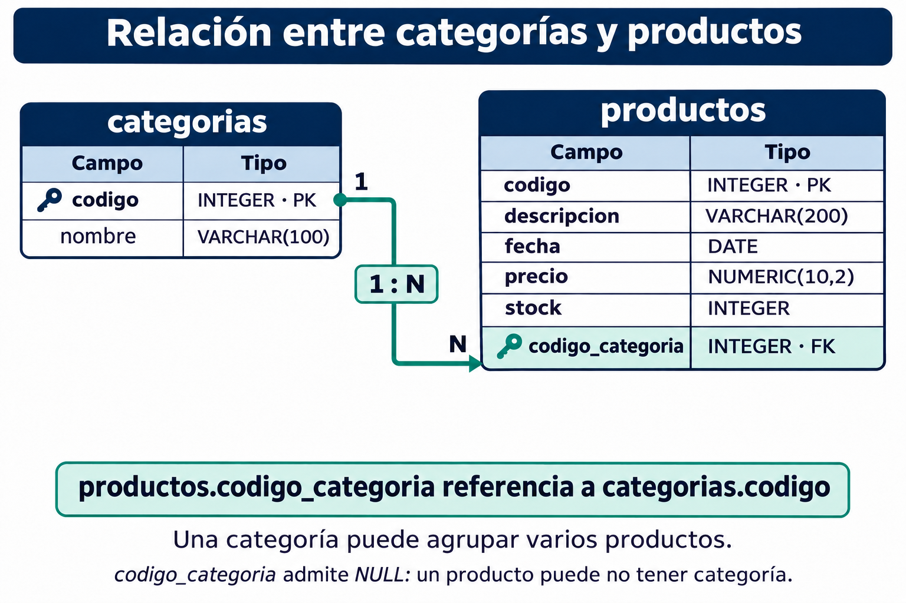

# CREATE TABLE

`CREATE TABLE` crea una tabla y define sus columnas, tipos de datos, valores por defecto y restricciones. La tabla se crea vacía, preparada para insertar datos más adelante.

!!! quote sintaxis "Sintaxis básica"

    <div class="syntax-table-wrap">
    <table class="syntax-table syntax-completa">
    <tbody>
    <tr><td><code>CREATE TABLE [ IF NOT EXISTS ] [esquema.]nombre_tabla (</code><br><code>    columna tipo_dato [ DEFAULT expresion ] [ restricciones_de_columna ]</code><br><code>    [, ...]</code><br><code>    [, restricciones_de_tabla ... ]</code><br><code>);</code></td></tr>
    </tbody></table>
    </div>

    **Opciones**

    - `IF NOT EXISTS`: evita el error si la tabla ya existe; no modifica su estructura.
    - `esquema.`: opcional; si se omite, en estas prácticas se utiliza `public` por defecto.
    - `DEFAULT`: valor que se aplica si se omite la columna.
    - `restricciones_de_columna`: reglas como `NOT NULL`, `PRIMARY KEY`, `UNIQUE`, `CHECK` o `REFERENCES`.
    - `restricciones_de_tabla`: reglas sobre una o varias columnas, separadas de las definiciones de columna mediante comas.

Las columnas se separan por comas. Usa identificadores sin espacios, acentos ni comillas.

En los ejemplos crearemos **categorias** y **productos** dentro de la base de datos **pruebas**. Este esquema muestra la estructura que iremos construyendo: empezaremos con tablas sin restricciones y, en el siguiente apartado, incorporaremos las claves y las reglas de validación.

{ width="800" }

!!! example practica "Pruébalo: Crear tablas sin restricciones"

    Desde la conexión a **pruebas**, ejecuta estas sentencias y comprueba que aparecen `categorias` y `productos` en el navegador de DBeaver. Una categoría permitirá agrupar productos; por ahora solo definimos los nombres y tipos de las columnas, sin añadir restricciones. Estas tablas de ejemplo pertenecen a `pruebas` y son independientes de las que construiremos en `juegos`.

    ```sql
    CREATE TABLE categorias (
        codigo INTEGER,
        nombre VARCHAR(100)
    );

    CREATE TABLE productos (
        codigo INTEGER,
        descripcion VARCHAR(200),
        fecha DATE,
        precio NUMERIC(10,2)
    );
    ```

    Las dos tablas están vacías y todavía no tienen claves primarias, claves ajenas ni otras restricciones. Conserva ambas: en el siguiente apartado las recrearemos para incorporar restricciones.

<a id="ejercicios-juegos"></a>

## Ejercicios: Crear las primeras tablas

Antes de empezar, completa [la creación de Juegos y su conexión](crear_bases_datos.md#crear-juegos-y-su-conexion). Consulta los [campos de referencia](4_crear_juegos.md#32-campos-de-referencia-y-pautas-de-trabajo) y guarda las sentencias en `02_juegos.sql`.

### Ejercicio 1: Crear categorias

!!! ejercicio "Juegos"

    Crea `categorias` con los campos y tipos de la [tabla de referencia](4_crear_juegos.md#32-campos-de-referencia-y-pautas-de-trabajo). Utiliza `SERIAL` en `id_categoria`, pero no añadas todavía la clave primaria ni otras restricciones explícitas.

### Ejercicio 2: Crear productos

!!! ejercicio "Juegos"

    Crea `productos` con todos sus campos. Utiliza `SERIAL` en `id_producto`, pero deja pendientes su clave primaria y su clave ajena hacia `categorias`. No añadas todavía restricciones de validación.

**Antes de continuar:** Al terminar deben existir `categorias` y `productos`, todavía sin PK ni FK. No las borres: continuarás con ellas después de estudiar las restricciones.

