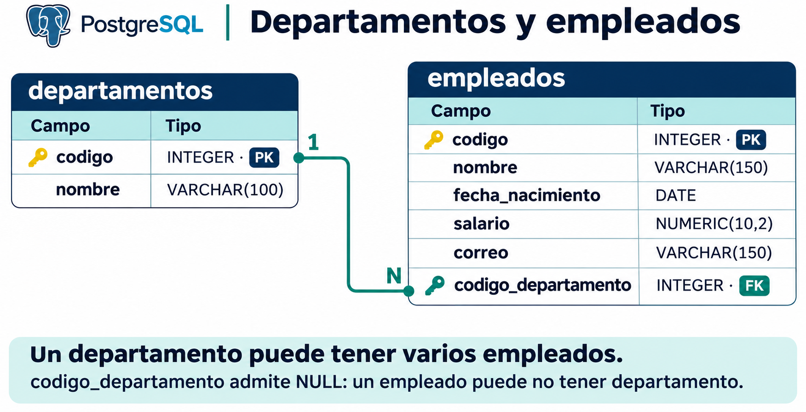
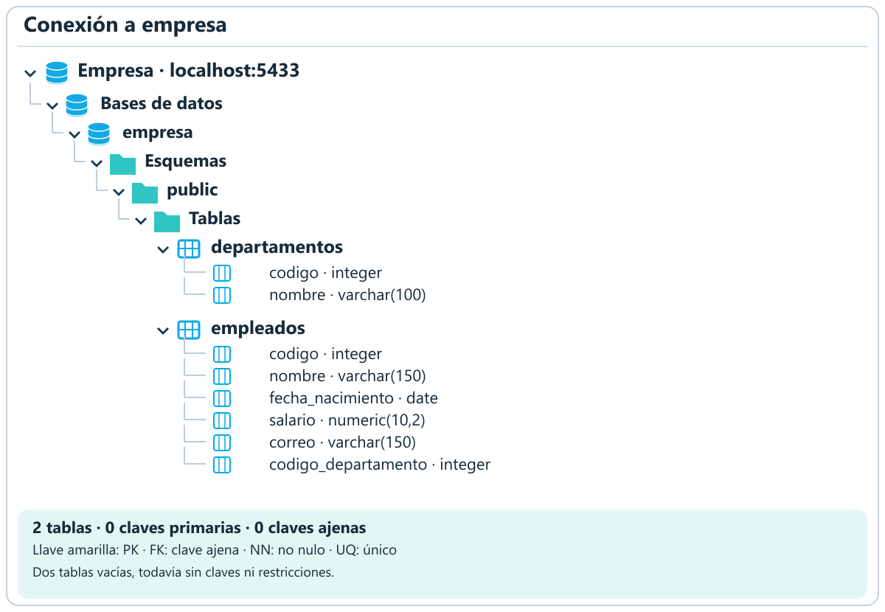

# CREATE TABLE

`CREATE TABLE` crea una tabla y define sus columnas, tipos de datos, valores por defecto y restricciones. La tabla se crea vacía, preparada para insertar datos más adelante.

!!! quote sintaxis "Sintaxis básica"

    <div class="syntax-table-wrap">
    <table class="syntax-table syntax-completa">
    <tbody>
    <tr><td><code>CREATE TABLE <span class="ddl-table">tabla</span></code><br><code> ( <span class="ddl-field">campo1</span> <span class="ddl-type">tipo [(tamaño)]</span> <span class="ddl-default">[DEFAULT valor]</span> <span class="ddl-constraint">[restriccion1] [restriccion2]</span> [...]</code><br><code> [, <span class="ddl-field">campo2</span> <span class="ddl-type">tipo [(tamaño)]</span> <span class="ddl-default">[DEFAULT valor]</span> <span class="ddl-constraint">[restriccion1] [restriccion2]</span>[...]</code><br><code> [, ...]]</code><br><code> [, <span class="ddl-constraint">restriccion_multiple1</span> [, ...]] )</code></td></tr>
    </tbody></table>
    </div>

    **Opciones**

    - <code class="ddl-table">tabla</code>: nombre de la tabla que se va a crear.
    - <code class="ddl-field">campo1</code>, <code class="ddl-field">campo2</code>: nombres de las columnas.
    - <code class="ddl-type">tipo [(tamaño)]</code>: tipo de dato y, cuando corresponda, su tamaño o precisión.
    - <code class="ddl-default">DEFAULT valor</code>: valor que se aplica si se omite la columna.
    - <code class="ddl-constraint">restriccion1</code>, <code class="ddl-constraint">restriccion2</code>, etc.: restricciones de columna, como <code><span class="ddl-constraint">NOT NULL</span></code>, <code><span class="ddl-constraint">PRIMARY KEY</span></code>, <code><span class="ddl-constraint">UNIQUE</span></code>, <code><span class="ddl-constraint">CHECK</span></code> o <code><span class="ddl-constraint">REFERENCES</span></code>.
    - <code class="ddl-constraint">restriccion_multiple1</code>: restricción de tabla, escrita después de las columnas y separada por comas.

!!! note "Apunte"

    Los corchetes indican partes opcionales y `...` indica que pueden añadirse más columnas o restricciones.

    Las columnas se separan por comas. Usa identificadores sin espacios, acentos ni comillas.

Vamos a comenzar la construcción progresiva de **Empresa**, presentada en la introducción. A continuación, para practicar la creación de tablas, crearemos **departamentos** y **empleados** dentro de la base de datos **empresa**. Un departamento puede tener varios empleados: la relación será **1:N**. Empezaremos con tablas sin restricciones y, en el siguiente apartado, incorporaremos las claves y las reglas de validación.

{ width="800" }

!!! example practica "Pruébalo: Crear tablas sin restricciones"

    Desde la conexión a **empresa**, ejecuta estas sentencias. Por ahora solo definimos los nombres y tipos de las columnas; todavía no añadimos claves ni otras restricciones.

    ```sql
    CREATE TABLE departamentos (
        codigo INTEGER,
        nombre VARCHAR(100)
    );

    CREATE TABLE empleados (
        codigo INTEGER,
        nombre VARCHAR(150),
        fecha_nacimiento DATE,
        salario NUMERIC(10,2),
        correo VARCHAR(150),
        codigo_departamento INTEGER
    );
    ```

    Actualiza el navegador de DBeaver y comprueba que aparecen las dos tablas. Están vacías y todavía no tienen claves primarias ni ajenas. Conserva ambas: en el apartado siguiente las volveremos a crear para incorporar restricciones.

Actualiza la conexión **Empresa** y despliega las tablas. Esta imagen orientativa muestra el estado al terminar el ejemplo:

{ width="800" }


<a id="ejercicios-juegos"></a>

## Ejercicios: Crear las primeras tablas

Antes de empezar, completa [la creación de Juegos y su conexión](crear_bases_datos.md#crear-juegos-y-su-conexion). Los campos y tipos necesarios aparecen en cada ejercicio. Guarda las sentencias en `juegos.sql`.

### <span class="exercise-title"><span class="exercise-icon">📝</span><span>Ejercicio 1: Crear categorias</span></span> {#ejercicio-1-crear-categorias}

!!! ejercicio "Juegos"

    Desde la conexión **Juegos**, escribe y ejecuta una sentencia `CREATE TABLE` para crear `categorias`, donde se guardarán las categorías que clasifican los productos de la tienda.

    **Modelo relacional**

    **CATEGORIAS** (<u>id_categoria</u>, descripcion)

    - PK: (id_categoria)

    Define las columnas con los tipos indicados en la tabla siguiente. `SERIAL` generará automáticamente los códigos de `id_categoria`.

    Aunque el modelo indica una clave primaria, **no la declares todavía ni añadas otras restricciones explícitas**. En este ejercicio practicaremos la definición de columnas y tipos; incorporaremos la PK en el ejercicio 11.

    **Campos de `categorias`**

    | Campo | Tipo de dato |
    | --- | --- |
    | `id_categoria` | `SERIAL` |
    | `descripcion` | `VARCHAR(100)` |


### <span class="exercise-title"><span class="exercise-icon">📝</span><span>Ejercicio 2: Crear productos</span></span> {#ejercicio-2-crear-productos}

!!! ejercicio "Juegos"

    Desde la conexión **Juegos**, crea `productos` para guardar los artículos que vende la tienda. Utiliza los campos y tipos de la tabla siguiente.

    **Modelo relacional**

    **PRODUCTOS** (<u>id_producto</u>, nombre, precio, stock, stock_minimo, <mark>id_categoria</mark>)

    - PK: (id_producto)
    - FK: id_categoria → CATEGORIAS(id_categoria)

    El modelo muestra las claves que tendrá la tabla al completar los ejercicios. **Por ahora no declares la PK ni la FK, ni añadas otras restricciones de validación**. `SERIAL` generará los códigos de `id_producto`; las claves se añadirán en el ejercicio 12.

    **Campos de `productos`**

    | Campo | Tipo de dato |
    | --- | --- |
    | `id_producto` | `SERIAL` |
    | `nombre` | `VARCHAR(200)` |
    | `precio` | `DECIMAL(10,2)` |
    | `stock` | `INTEGER` |
    | `stock_minimo` | `INTEGER` |
    | `id_categoria` | `INTEGER` |

**Antes de continuar:** Al terminar deben existir `categorias` y `productos`, todavía sin PK ni FK. No las borres: continuarás con ellas después de estudiar las restricciones.

Actualiza la conexión **Juegos** en DBeaver y despliega **Bases de datos → juegos → Esquemas → public → Tablas**. Abre las columnas de cada tabla para comprobar sus nombres y tipos. El árbol quedará como en esta imagen orientativa:

{ width="600" }

