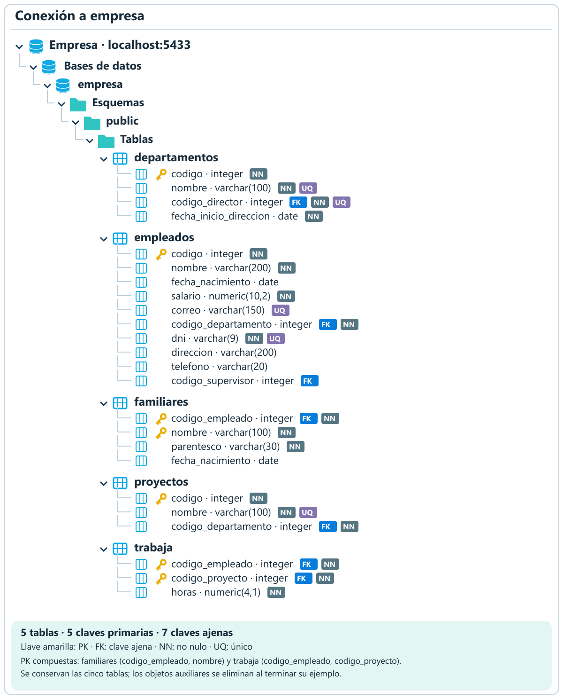

# Tipos enumerados

Un tipo enumerado limita una columna a una lista de valores permitidos. `CREATE TYPE ... AS ENUM` define esa lista; `ALTER TYPE` permite añadir o renombrar valores, y `DROP TYPE` elimina el tipo cuando ya no se necesita.

!!! quote sintaxis "Sintaxis básica"

    <div class="syntax-table-wrap">
    <table class="syntax-table syntax-completa">
    <tbody>
    <tr><td><code>CREATE TYPE [<span class="ddl-table">esquema</span>.]<span class="ddl-table">nombre</span> AS <span class="ddl-type">ENUM</span> (<span class="ddl-default">'valor1'</span> [, ...]);</code></td></tr>
    <tr><td><code>ALTER TYPE [<span class="ddl-table">esquema</span>.]<span class="ddl-table">nombre</span> <span class="ddl-option">ADD</span> <span class="ddl-option">VALUE</span> <span class="ddl-default">'nuevo_valor'</span>;</code><br/><br/><br/><code>ALTER TYPE [<span class="ddl-table">esquema</span>.]<span class="ddl-table">nombre</span></code><br/><code>    <span class="ddl-option">RENAME</span> <span class="ddl-option">VALUE</span> <span class="ddl-default">'valor_existente'</span> <span class="ddl-option">TO</span> <span class="ddl-default">'nuevo_valor'</span>;</code></td></tr>
    <tr><td><code>DROP TYPE [ <span class="ddl-option">IF EXISTS</span> ] [<span class="ddl-table">esquema</span>.]<span class="ddl-table">nombre</span> [, ...]</code><br/><code>    [ <span class="ddl-option">CASCADE</span> | <span class="ddl-option">RESTRICT</span> ];</code></td></tr>
    </tbody></table>
    </div>

    **Opciones**

    **<code>CREATE TYPE</code>**

    - <code>AS ENUM</code>: lista de valores permitidos entre comillas simples.

    **<code>ALTER TYPE</code>**

    - <code><span class="ddl-option">ADD</span> <span class="ddl-option">VALUE</span></code>: añade un valor al final de la lista.
    - <code><span class="ddl-option">RENAME</span> <span class="ddl-option">VALUE</span></code>: cambia un valor existente.

    **<code>DROP TYPE</code>**

    - <code><span class="ddl-option">IF EXISTS</span></code>: evita el error si no existe.
    - <code><span class="ddl-option">RESTRICT</span></code>: impide borrar si hay dependencias (por defecto).
    - <code><span class="ddl-option">CASCADE</span></code>: elimina también objetos dependientes.


No existe una operación directa para eliminar un único valor de un ENUM. Aquí utilizaremos los tipos enumerados para limitar los valores admitidos por una columna.

!!! example practica "Pruébalo: Probar un tipo enumerado"

    Crea el tipo y la tabla; revisa los valores permitidos y el valor por defecto antes de ejecutar los borrados.

    ```sql
    CREATE TYPE estado_producto_demo AS ENUM ('Disponible', 'Agotado', 'En espera');
    CREATE TABLE inventario_demo (
        id_producto SERIAL PRIMARY KEY,
        estado estado_producto_demo DEFAULT 'Disponible'
    );
    DROP TABLE inventario_demo;
    DROP TYPE estado_producto_demo;
    ```

Actualiza la conexión **Empresa** y despliega las tablas. Esta imagen orientativa muestra el estado al terminar el ejemplo:

{ width="800" }


<a id="ejercicios-juegos"></a>

## Ejercicios: Combinar dominios, tipos y restricciones

Realiza este ejercicio de ampliación después de estudiar CREATE TABLE, restricciones, dominios y tipos enumerados. Trabaja en **empresa** y añade las sentencias a `03_objetos_empresa.sql`.

### <span class="exercise-title"><span class="exercise-icon">📝</span><span>Ejercicio 14: Combinar dominio, tipo y restricciones</span></span> {#ejercicio-14-combinar-dominio-tipo-y-restricciones}

!!! ejercicio "Empresa"

    En la conexión **Empresa**, crea los objetos auxiliares necesarios para definir esta tabla y comprobar sus restricciones. Al terminar, elimina solo esos objetos de demostración.

    **Modelo relacional**

    **PRODUCTOS_DEMO** (<u>id_producto</u>, nombre, precio, stock, stock_minimo, codigo_barras, estado)

    - PK: (id_producto)

    Realiza estos pasos:

    1. **Crea el dominio `codigo_barras_demo`**, basado en `VARCHAR(13)`, para admitir únicamente textos formados por exactamente 13 dígitos.

    2. **Crea el tipo enumerado `estado_producto_demo`**, con los valores `Disponible`, `Agotado` y `En espera`.

    3. **Crea la tabla `productos_demo`** con los campos del modelo. Utiliza `SERIAL` en `id_producto` y decláralo como clave primaria. Aplica el dominio a `codigo_barras` y el tipo enumerado a `estado`.

    4. **Añade las validaciones**: precio, stock y stock mínimo deben ser no negativos. Define además `stock >= stock_minimo` como **restricción de tabla con nombre**.

    5. **Comprueba las restricciones** insertando una fila válida y varias que deban rechazarse. Ejecuta las inserciones por separado.

    6. **Reflexiona**: explica por qué en un inventario real puede ser útil permitir que el stock esté por debajo del mínimo.

    7. **Elimina los objetos de demostración**: primero la tabla y después el tipo enumerado y el dominio.

    El dominio solo comprueba el formato de 13 dígitos: no verifica el dígito de control del código de barras ni indica el país de fabricación.

**Antes de continuar:** Elimina los objetos de demostración en el orden adecuado, sin modificar la base de datos Juegos.

