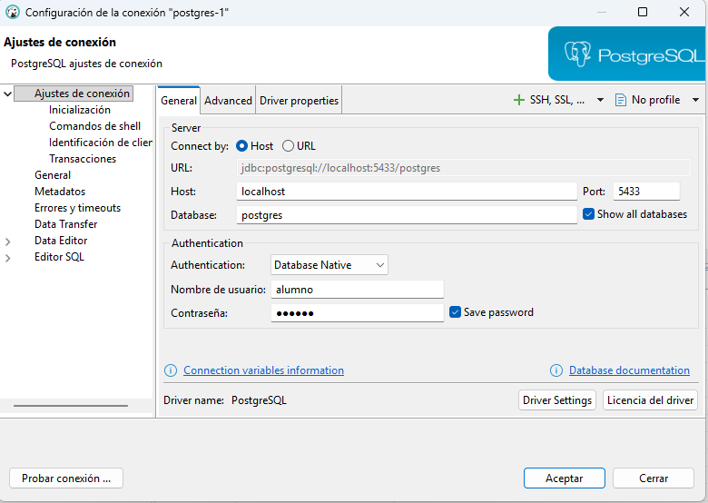
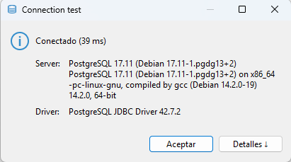
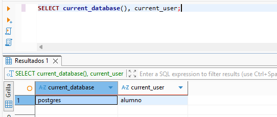

# Conectar desde DBeaver

**DBeaver Community** será el cliente con el que crearás tablas y ejecutarás consultas. PostgreSQL se ejecuta en el contenedor preparado en [PostgreSQL local con Docker Compose](../entorno_postgresql.md).

## Instalar y conectar

Descarga [DBeaver Community](https://dbeaver.io/download/) y crea una conexión PostgreSQL:

<div class="image-pair-grid" markdown>

<div markdown>

| Campo | Valor |
| --- | --- |
| Host | `localhost` |
| Puerto | `5433` |
| Usuario | `alumno` |
| Contraseña | `alumno` |
| Base de datos inicial | `postgres` |

</div>

<div class="image-panel" markdown>



</div>

</div>

!!! warning "Mostrar todas las bases de datos"
    En la configuración de la conexión, marca **Show all databases** (Mostrar todas las bases de datos). Así podrás ver las bases de datos que vayamos creando durante el curso: `pruebas`, `moviles` y `juegos`.

    Después de crear una base de datos, actualiza la conexión en el navegador de DBeaver para que aparezca.

Pulsa **Probar conexión**, descarga el controlador si se solicita y guarda. 


## Trabajar en la base correcta

Abre un editor SQL desde la conexión que necesitas y verifica:

```sql
SELECT current_database(), current_user;
```

En esta conexión inicial debe aparecer `postgres` y el usuario `alumno`. Cambiar el nombre de la conexión no cambia la base a la que está conectada: revisa el campo **Base de datos**.




