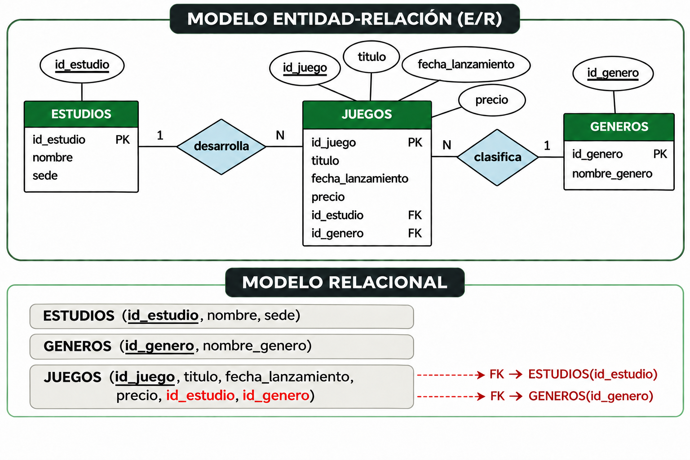
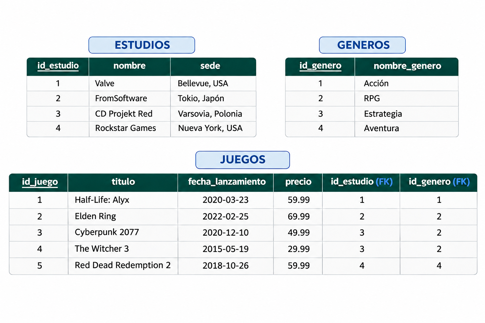

# MundoJuegos

Los ejemplos de este tema se basan en **MundoJuegos**, una plataforma simplificada de gestión de videojuegos. Es una base de datos sencilla con 3 tablas principales, ideal para comprender los fundamentos del DQL.

## Modelo E/R y modelo relacional

## Tablas con datos de ejemplo

Puedes encontrar el script completo para montar estas bases de datos en tu entorno local en el archivo [database_setup.sql](database_setup.sql).

Licenciado bajo la [Licencia Creative Commons Reconocimiento NoComercial
CompartirIgual 3.0](http://creativecommons.org/licenses/by-nc-sa/3.0/)
