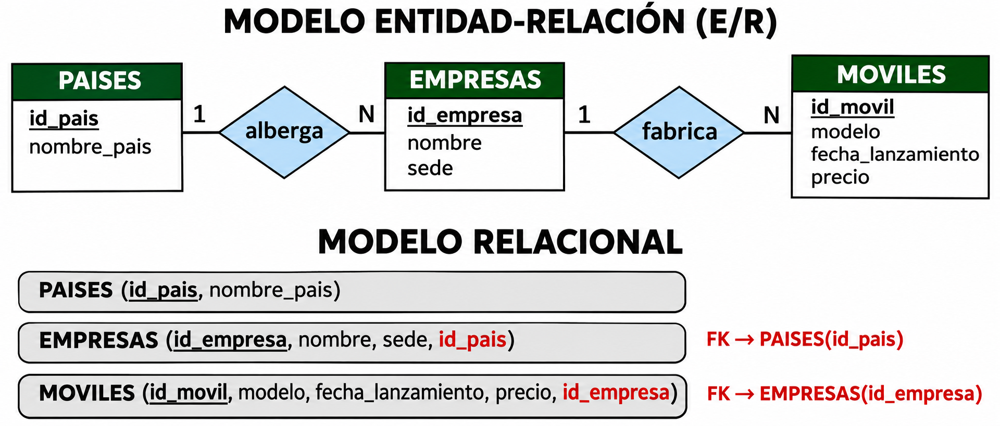
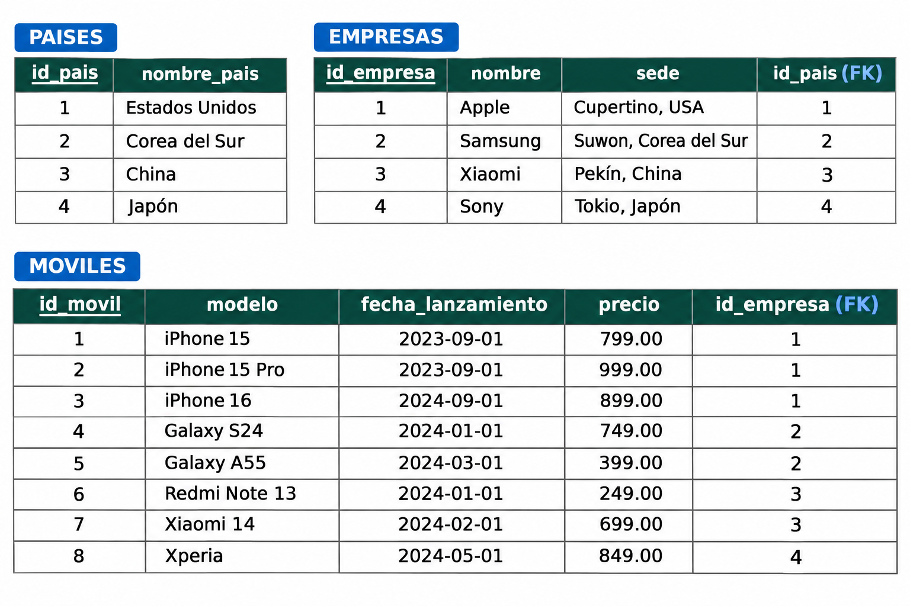

# MundoMoviles

Los ejemplos de este tema se basan en **MundoMoviles**, una base de datos de fabricantes y modelos de teléfonos móviles, con tres tablas: `paises`, `empresas` y `moviles`.

Las empresas, como Apple, Samsung, Xiaomi o Sony, fabrican distintos modelos de móviles. Los precios y las fechas de los datos de ejemplo son ficticios y sirven para practicar SQL.

La estructura sigue la misma cadena que Geo (**comarcas → poblaciones → institutos**):

**PAISES (1) → (N) EMPRESAS (1) → (N) MOVILES**

- Un país puede albergar varias empresas; cada empresa pertenece a un país.
- Una empresa puede fabricar varios móviles; cada móvil pertenece a una empresa.

## Modelo E/R y modelo relacional

## Tablas con datos de ejemplo

Crea las tablas en la [práctica DDL de MundoMoviles](../BD_PostgreSQL_DDL/3_crear_mundomoviles.md) y carga después sus [datos](../recursos/postgresql/sql/mundomoviles-datos.sql) siguiendo el [tema DML](../BD_PostgreSQL_DML/1_introducci.md).

Licenciado bajo la [Licencia Creative Commons Reconocimiento NoComercial
CompartirIgual 3.0](http://creativecommons.org/licenses/by-nc-sa/3.0/)
