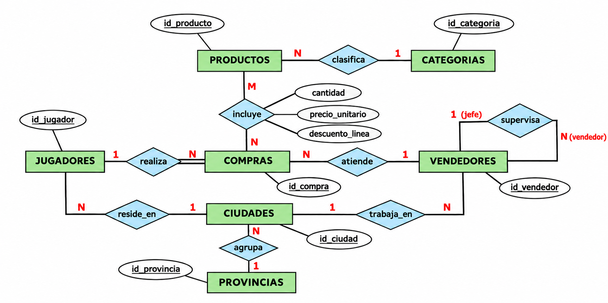

# Juegos

Los ejercicios de los distintos temas se basan en **Juegos**, una base de datos de una tienda de videojuegos, consolas y accesorios, con ocho tablas: `categorias`, `productos`, `jugadores`, `vendedores`, `compras`, `lineas_compra`, `ciudades` y `provincias`.

Los jugadores realizan compras atendidas por vendedores. Cada compra incluye uno o varios productos, agrupados en categorías. Los jugadores y vendedores están asociados a ciudades, que pertenecen a provincias. Además, un vendedor puede supervisar a otros vendedores.

Los precios, las fechas y los datos personales de los ejemplos son ficticios y sirven para practicar SQL.

## Modelo E/R

## Modelo relacional

???+ success "Solución propuesta"

    - **CATEGORIAS** (<u>id_categoria</u>, descripcion)
        - PK: (id_categoria)
    - **PRODUCTOS** (<u>id_producto</u>, nombre, precio, stock, stock_minimo, <mark>id_categoria</mark>)
        - PK: (id_producto)
        - FK: id_categoria->CATEGORIAS(id_categoria)
    - **LINEAS_COMPRA** (<u><mark>id_compra</mark>, num_linea</u>, <mark>id_producto</mark>, cantidad, precio_unitario, descuento_linea)
        - PK: (id_compra, num_linea)
        - FK: id_compra->COMPRAS(id_compra)
        - FK: id_producto->PRODUCTOS(id_producto) [no nulo]
    - **COMPRAS** (<u>id_compra</u>, fecha, <mark>id_jugador</mark>, <mark>id_vendedor</mark>, iva, descuento)
        - PK: (id_compra)
        - FK: id_jugador->JUGADORES(id_jugador) [no nulo]
        - FK: id_vendedor->VENDEDORES(id_vendedor) [no nulo]
    - **JUGADORES** (<u>id_jugador</u>, nombre, direccion, codigo_postal, <mark>id_ciudad</mark>)
        - PK: (id_jugador)
        - FK: id_ciudad->CIUDADES(id_ciudad)
    - **VENDEDORES** (<u>id_vendedor</u>, nombre, direccion, codigo_postal, <mark>id_ciudad</mark>, <mark>id_jefe</mark>)
        - PK: (id_vendedor)
        - FK: id_ciudad->CIUDADES(id_ciudad)
        - FK: id_jefe->VENDEDORES(id_vendedor)
    - **CIUDADES** (<u>id_ciudad</u>, nombre, <mark>id_provincia</mark>)
        - PK: (id_ciudad)
        - FK: id_provincia->PROVINCIAS(id_provincia)
    - **PROVINCIAS** (<u>id_provincia</u>, nombre)
        - PK: (id_provincia)

## Relaciones

- Una **categoría** clasifica varios **productos**: 1:N.
- Un **jugador** realiza varias **compras**: 1:N, con **participación total de compras** (doble línea entre `compras` y `realiza`). Toda compra pertenece a un jugador; un jugador puede no haber realizado compras.
- Un **vendedor** atiende varias **compras**: 1:N.
- Una **compra** incluye varios **productos** y un producto puede aparecer en varias compras: N:M. Esta relación se transforma en **lineas_compra**.
- Una **ciudad** tiene varios **jugadores** y varios **vendedores**: dos relaciones 1:N.
- Una **provincia** agrupa varias **ciudades**: 1:N.
- Un **vendedor jefe** supervisa a varios vendedores: relación reflexiva 1:N.

La clave primaria de `lineas_compra` es `(id_compra, num_linea)`. Cada compra debe tener un jugador y un vendedor; cada línea debe referenciar un producto.

<!--
## Datos para las prácticas

Los ejemplos incluyen videojuegos como Minecraft y Elden Ring, consolas, periféricos y merchandising. Los precios son datos ficticios para practicar SQL.

`precio_unitario` guarda el precio del producto en el momento de la compra. `descuento_linea`, `descuento` e `iva` se expresan en porcentajes: primero se aplican los descuentos de línea, después el descuento general y finalmente el IVA. Un descuento nulo se trata como 0 cuando se calcula el total.

El script incluye jugadores, vendedores y compras de distintos meses de 2024, productos con stock nulo y líneas con descuento nulo para practicar filtros, agrupaciones y `COALESCE`.

Crea las tablas en la [práctica DDL de Juegos](../BD_PostgreSQL_DDL/4_crear_juegos.md) y carga después el [archivo de datos](../recursos/postgresql/sql/juegos-datos.sql) durante el [tema DML](../BD_PostgreSQL_DML/1_introducci.md).

Licenciado bajo la [Licencia Creative Commons Reconocimiento NoComercial CompartirIgual 3.0](http://creativecommons.org/licenses/by-nc-sa/3.0/)
-->