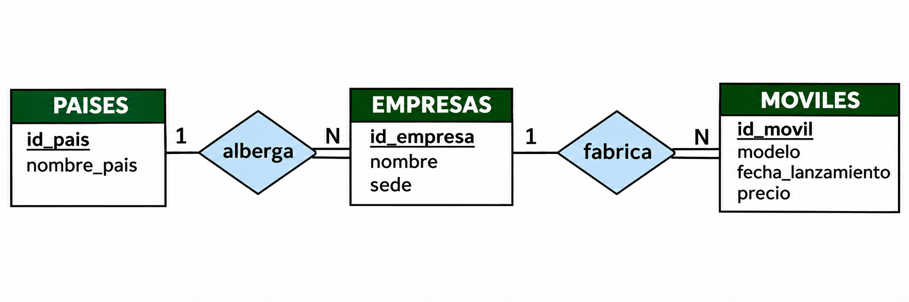
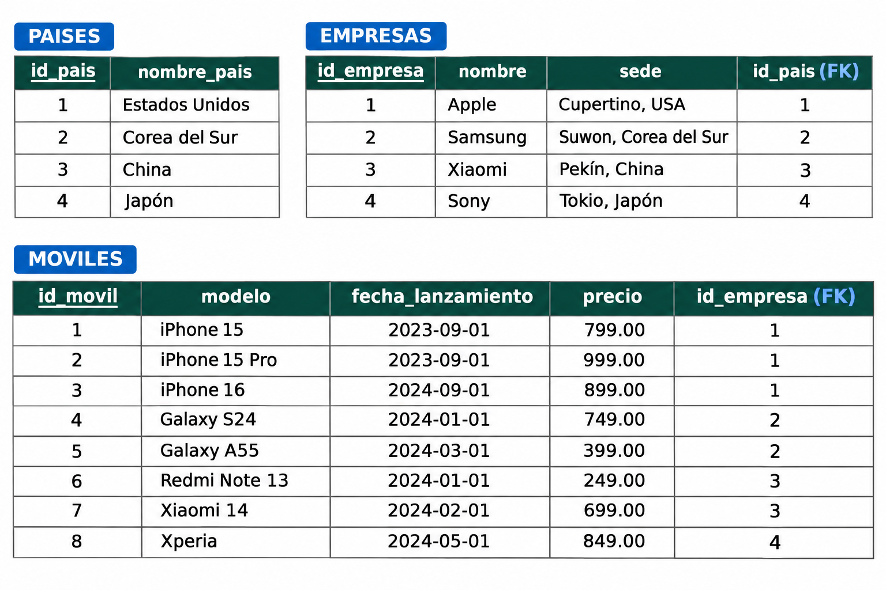

# Moviles

Los ejemplos de este tema se basan en **Moviles**, una base de datos de fabricantes y modelos de teléfonos móviles, con tres tablas: `paises`, `empresas` y `moviles`.

Las empresas, como Apple, Samsung, Xiaomi o Sony, fabrican distintos modelos de móviles. Los precios y las fechas de los datos de ejemplo son ficticios y sirven para practicar SQL.

La estructura forma una cadena de dos relaciones 1:N:

**PAISES (1) → (N) EMPRESAS (1) → (N) MOVILES**

- Un país puede albergar varias empresas; cada empresa pertenece a un país.
- Una empresa puede fabricar varios móviles; cada móvil pertenece a una empresa.

## Modelo E/R

## Modelo relacional

???+ success "Solución propuesta"

    - **PAISES** (<u>id_pais</u>, nombre_pais)
        - PK: (id_pais)
    - **EMPRESAS** (<u>id_empresa</u>, nombre, sede, <mark>id_pais</mark>)
        - PK: (id_empresa)
        - FK: id_pais->PAISES(id_pais) [no nulo]
    - **MOVILES** (<u>id_movil</u>, modelo, fecha_lanzamiento, precio, <mark>id_empresa</mark>)
        - PK: (id_movil)
        - FK: id_empresa->EMPRESAS(id_empresa) [no nulo]

## Tablas con datos de ejemplo

<!--
Crea las tablas en la [práctica DDL de Moviles](../BD_PostgreSQL_DDL/3_crear_moviles.md) y carga después sus [datos](../recursos/postgresql/sql/moviles-datos.sql) siguiendo el [tema DML](../BD_PostgreSQL_DML/1_introducci.md).

Licenciado bajo la [Licencia Creative Commons Reconocimiento NoComercial
CompartirIgual 3.0](http://creativecommons.org/licenses/by-nc-sa/3.0/)
-->