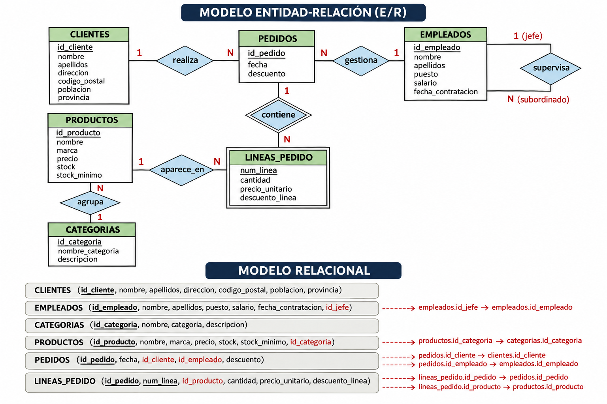

# TecnoTienda

Para los ejercicios trabajaremos con **TecnoTienda**, un e-commerce de productos tecnológicos y gaming más completo que nos permitirá realizar consultas más avanzadas.

## Modelo E/R y modelo relacional

Puedes encontrar el script completo para montar estas bases de datos en tu entorno local en el archivo [database_setup.sql](database_setup.sql).

Licenciado bajo la [Licencia Creative Commons Reconocimiento NoComercial
CompartirIgual 3.0](http://creativecommons.org/licenses/by-nc-sa/3.0/)
