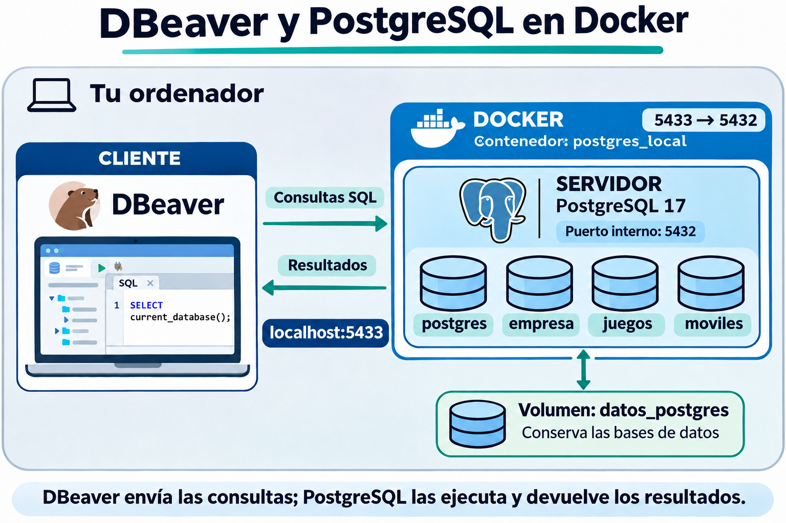

---
hide:
  - toc
---

# Presentación

En este apartado se reúnen los **modelos entidad-relación (E/R) y relacionales** de las bases de datos **Empresa**, **Juegos** y **Moviles** que utilizaremos durante el curso.

Los dejamos aquí para tenerlos **fácilmente localizables desde cualquier tema**. Podrás volver a ellos para consultar las entidades y relaciones, las tablas, sus campos y las claves primarias y ajenas, tanto al crear la estructura en **DDL** como al trabajar con los datos en **DML** o realizar consultas en **DQL**.

Este será nuestro entorno de trabajo cuando estén creadas las bases de datos: `empresa` para los ejemplos guiados y `juegos` y `moviles` para las prácticas, junto a la base inicial `postgres`. Todas estarán en el **mismo servidor PostgreSQL y contenedor Docker**; desde DBeaver elegiremos a cuál conectarnos.

{ width="600" }

- [Empresa](empresa.md): departamentos, empleados, proyectos y familiares; se construye progresivamente en `empresa` con los ejemplos guiados de DDL.
- [Juegos](juegos.md): tienda de videojuegos, consolas y accesorios, utilizada en los ejercicios.
- [Moviles](moviles.md): base de datos de países, empresas y modelos de teléfonos móviles, utilizada en los ejemplos de DQL. Su preparación se realiza en la [introducción a DQL](BD_PostgreSQL_DQL/0_introducci.md).
