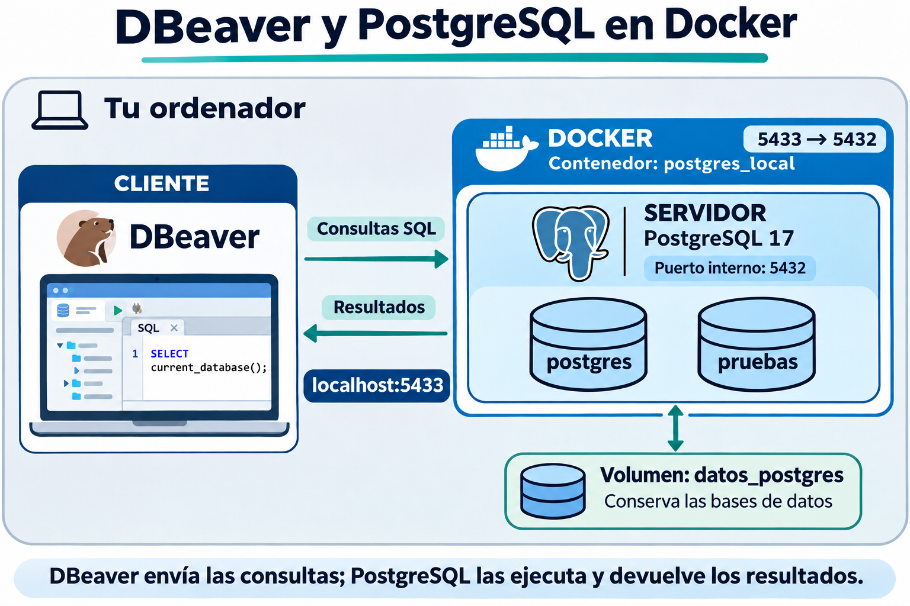
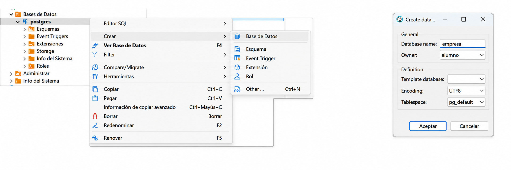
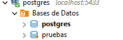
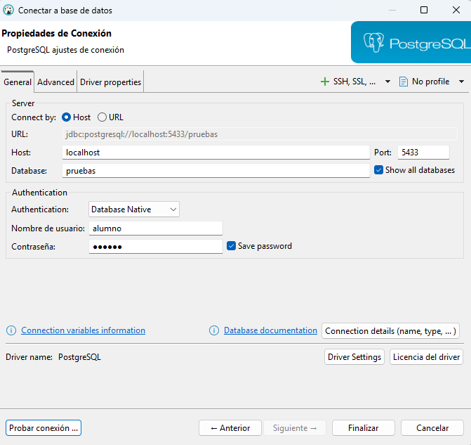
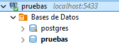
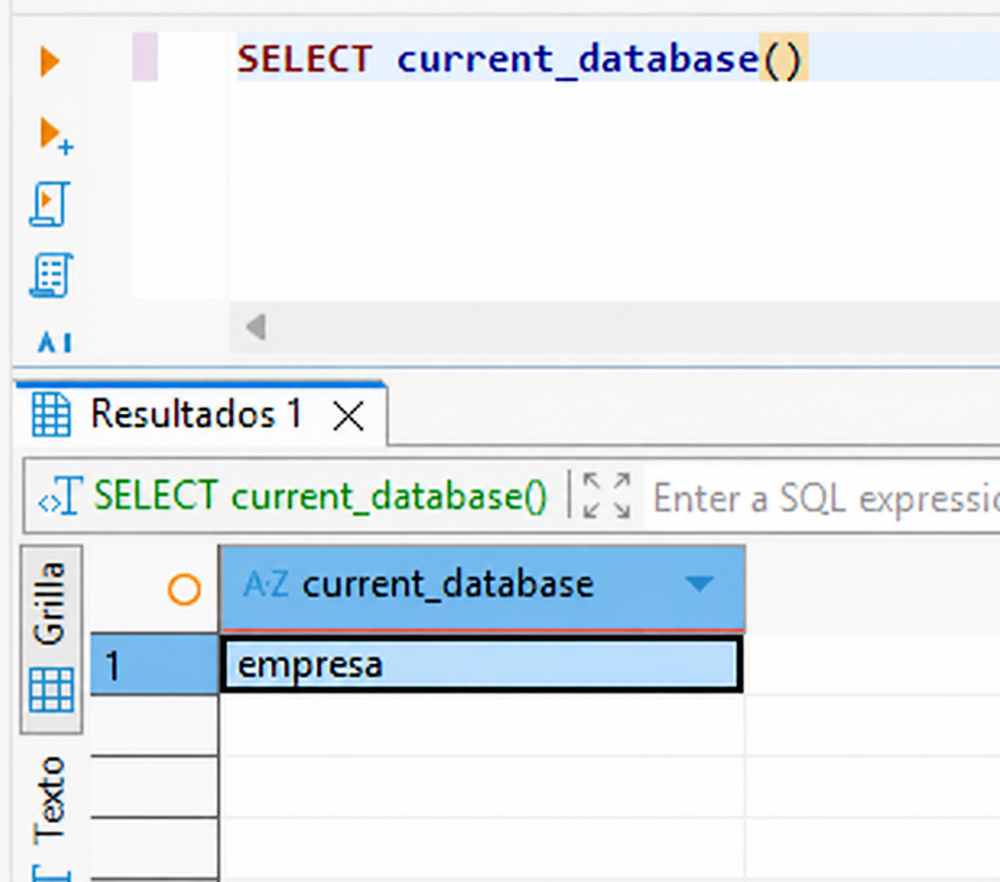

# 4. Crear la base de pruebas y su conexión

Vamos a crear una base de datos llamada **pruebas** para realizar los ejemplos de los apuntes y experimentar con las sentencias SQL. Será nuestro espacio de práctica para crear, modificar y eliminar objetos sin afectar a las bases de datos que utilizaremos más adelante en los ejercicios. También crearemos una conexión en DBeaver para trabajar directamente con ella.

La imagen muestra cómo quedará el entorno al crear `pruebas`: estará junto a `postgres` en el mismo servidor PostgreSQL, dentro del contenedor que ya tenemos en marcha.



## 4.1 Crear la base de datos

Vamos a crear `pruebas` **dentro del servidor PostgreSQL que se ejecuta en nuestro contenedor Docker**. DBeaver será el cliente desde el que enviaremos la orden de creación.

La conexión que acabamos de configurar utiliza la base inicial `postgres` para acceder al servidor. Desde esa conexión crearemos otra base de datos, `pruebas`, en el mismo servidor. **`postgres` y `pruebas` serán dos bases de datos independientes, al mismo nivel**: `pruebas` no se crea dentro de la base `postgres`, sino dentro del servidor PostgreSQL.

Puedes crearla **con una sentencia SQL o en modo gráfico**. Elige una de las dos opciones; no es necesario hacer ambas.

### Opción 1: con una sentencia SQL

Desde la conexión a `postgres`, abre un editor SQL y ejecuta esta sentencia por separado:

```sql
CREATE DATABASE pruebas;
```

Por ahora, ejecuta esta sentencia para preparar la base de datos de las prácticas. En el tema de **DDL**, en el apartado [Crear bases de datos](BD_PostgreSQL_DDL/crear_bases_datos.md), estudiaremos su sintaxis y sus opciones.


### Opción 2: en modo gráfico

1. En el navegador de DBeaver, despliega la conexión a PostgreSQL y localiza **Bases de datos / Databases**. Debes tener marcada la opción **Show all databases** en la configuración de la conexión.
2. Haz clic derecho sobre **Bases de datos / Databases** y selecciona **Crear → Base de datos / Create → Database**.
3. Escribe **pruebas** como nombre y deja **alumno** como propietario.
4. Confirma la creación y guarda los cambios si DBeaver lo solicita.
5. Actualiza el nodo **Bases de datos / Databases** para comprobar que aparece `pruebas`.



Después de crearla por cualquiera de las dos opciones, actualiza **Bases de datos / Databases**. Debe aparecer `pruebas` junto a `postgres`:

{ width="300" }

## 4.2 Crear la conexión a pruebas

La base de datos **pruebas ya está creada**. Ahora guardaremos en DBeaver una conexión que acceda directamente a ella. Utilizaremos el mismo servidor y usuario de antes; solo cambiaremos la base de datos de destino, de `postgres` a `pruebas`.

La base `postgres` se utiliza como punto de acceso inicial al servidor. Para los ejemplos conviene utilizar `pruebas`, donde podremos crear, modificar y eliminar tablas sin mezclar los ejercicios con esa base inicial. Cada editor SQL trabaja sobre una base de datos concreta: si lo abrimos desde la conexión a `postgres`, las tablas se crearán allí, aunque veamos `pruebas` en el navegador.

Guardar una **conexión específica a pruebas** facilita abrir los editores directamente en la base correcta y reconocer dónde estamos trabajando. No es obligatorio crear otra conexión para acceder a ella, pero sí es una forma más clara de organizar las prácticas y evitar errores. La conexión no crea otro servidor ni otra base de datos: solo guarda los datos de acceso a la que ya hemos creado.

<div class="connection-step" markdown>

#### Paso 1. Configurar una nueva conexión

En la barra de herramientas de DBeaver, abre **Nueva conexión → PostgreSQL** e introduce estos datos:

| Campo | Valor |
| --- | --- |
| Host | `localhost` |
| Puerto | `5433` |
| Base de datos | **`pruebas`** |
| Usuario | `alumno` |
| Contraseña | `alumno` |

La ventana de conexión debe tener `pruebas` en el campo **Database**:

{ .connection-capture }

Marca también **Show all databases** (Mostrar todas las bases de datos), que aparece sin marcar en la captura.

</div>

<div class="connection-step" markdown>

#### Paso 2. Probar y guardar

Pulsa **Probar conexión** y, si la prueba es correcta, **Finalizar**.

La nueva conexión aparecerá en el **Navegador de bases de datos**. Puedes renombrarla como **Pruebas** para reconocerla fácilmente. Conserva también la conexión inicial a `postgres`.

{ width="300" }

</div>

<div class="connection-step" markdown>

#### Paso 3. Comprobar la base de datos del editor

Haz clic derecho sobre la **nueva conexión a pruebas** y selecciona **Editor SQL → Nuevo script SQL**. Ejecuta esta consulta con **Ctrl + Intro**:

```sql
SELECT current_database();
```

El resultado debe ser **`pruebas`**, como en esta captura:

{ width="350" }

Si el resultado es `postgres`, abre el editor desde la nueva conexión y revisa que su campo **Base de datos** sea `pruebas`. Cambiar solo el nombre de la conexión no cambia su destino.

</div>

A partir de ahora, utiliza la conexión **Pruebas** para ejecutar los ejemplos de los apuntes.
