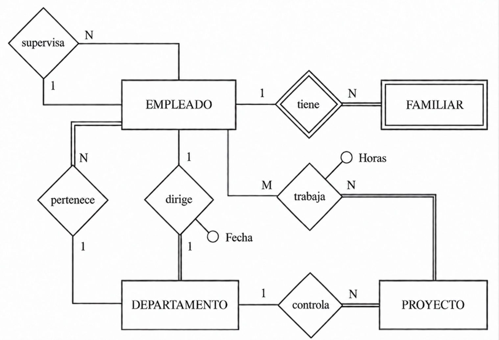

# Empresa

Retomamos la **empresa de departamentos y proyectos** estudiada en el modelo E/R y en el modelo relacional. **Empresa se utiliza para los ejemplos guiados de los apuntes**. En DDL construiremos sus cinco tablas progresivamente **dentro de la base de datos `empresa`**: empezaremos con departamentos y empleados sin restricciones y completaremos las tablas y relaciones a medida que avancemos en las explicaciones.

Cada empleado pertenece a un departamento y puede tener un supervisor. Cada departamento tiene un director y controla proyectos. Los empleados pueden trabajar en varios proyectos, con unas horas semanales en cada uno, y tener varios familiares.

## Modelo E/R

{ width="900" }

El diagrama es el utilizado en el tema de modelo relacional. Muestra las entidades y relaciones; se omiten los atributos de las entidades para facilitar su lectura. Las dobles líneas indican participación total y `FAMILIAR` es una entidad débil identificada a través del empleado.

## Modelo relacional

Esta es la estructura final que construiremos en los ejemplos de DDL. Adaptamos los nombres a SQL y conservamos `codigo` como identificador, como en los primeros ejemplos. El DNI es una clave candidata del empleado; `salario` corresponde al sueldo del modelo original.

???+ success "Solución propuesta"

    - **DEPARTAMENTOS** (<u>codigo</u>, nombre, <mark>codigo_director</mark>, fecha_inicio_direccion)
        - PK: (codigo)
        - UNIQUE: (nombre), (codigo_director)
        - FK: codigo_director->EMPLEADOS(codigo) [no nulo] [único]
    - **EMPLEADOS** (<u>codigo</u>, dni, nombre, direccion, telefono, fecha_nacimiento, salario, correo, <mark>codigo_departamento</mark>, <mark>codigo_supervisor</mark>)
        - PK: (codigo)
        - UNIQUE: (dni), (correo)
        - FK: codigo_departamento->DEPARTAMENTOS(codigo) [no nulo]
        - FK: codigo_supervisor->EMPLEADOS(codigo)
    - **PROYECTOS** (<u>codigo</u>, nombre, <mark>codigo_departamento</mark>)
        - PK: (codigo)
        - UNIQUE: (nombre)
        - FK: codigo_departamento->DEPARTAMENTOS(codigo) [no nulo]
    - **FAMILIARES** (<u><mark>codigo_empleado</mark>, nombre</u>, parentesco, fecha_nacimiento)
        - PK: (codigo_empleado, nombre)
        - FK: codigo_empleado->EMPLEADOS(codigo)
    - **TRABAJA** (<u><mark>codigo_empleado</mark>, <mark>codigo_proyecto</mark></u>, horas)
        - PK: (codigo_empleado, codigo_proyecto)
        - FK: codigo_empleado->EMPLEADOS(codigo)
        - FK: codigo_proyecto->PROYECTOS(codigo)

Las columnas que forman parte de una PK son obligatorias. En los ejemplos también definiremos otras reglas con `NOT NULL`, `UNIQUE` y `CHECK`.

## Relaciones

- **Departamento–empleados:** 1:N. Todo empleado pertenece a un departamento.
- **Empleado–supervisor:** relación reflexiva 1:N. El supervisor es opcional.
- **Empleado–departamento dirigido:** 1:1. Todo departamento tiene director; un empleado dirige como máximo un departamento.
- **Departamento–proyectos:** 1:N. Todo proyecto pertenece a un departamento.
- **Empleado–familiares:** 1:N, con identificación del familiar mediante el empleado y el nombre del familiar.
- **Empleados–proyectos:** N:M, transformada en `trabaja`, que guarda las horas semanales.

La regla del modelo E/R «todo proyecto tiene al menos un empleado» necesita un control adicional: no queda garantizada solo con las PK y FK de `trabaja`.

Consulta la [secuencia de construcción de Empresa](BD_PostgreSQL_DDL/1_introducci.md) para saber en qué apartado incorporaremos cada parte. Estas tablas se conservarán para los ejemplos posteriores.
