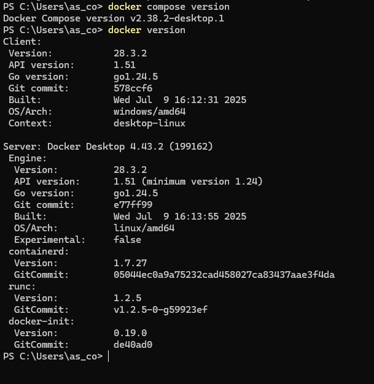

# Servidor PostgreSQL con Docker 

En este apartado prepararemos un **contenedor Docker con PostgreSQL**, el sistema gestor de bases de datos que utilizaremos durante el curso. Así podremos trabajar en nuestro propio ordenador sin instalar PostgreSQL directamente, con un entorno que será fácil de arrancar y detener.

Utilizaremos **Docker Compose** para configurar y poner en marcha el servidor. Más adelante, en el tema de **DDL**, crearemos dentro de ese servidor las bases de datos **Moviles** y **Juegos**, junto con sus tablas y relaciones. Después insertaremos los datos en **DML** y realizaremos consultas en **DQL**.

## 2.1 Instalación


- En Windows y macOS, instala [Docker Desktop](https://docs.docker.com/desktop/) y ábrelo. En Windows utiliza el motor de contenedores Linux y completa la configuración de WSL 2 que solicita el instalador.
- En Ubuntu, si Docker ya está instalado en el aula, no lo reinstales. En un equipo personal sigue la [instalación oficial de Docker Engine](https://docs.docker.com/engine/install/ubuntu/), que incluye `docker-compose-plugin`.


Comprueba en una terminal:

```bash
docker version
docker compose version
```

`docker version` debe mostrar tanto **Client** como **Server**. Si solo aparece Client o un error de conexión, inicia Docker Desktop o el servicio Docker antes de continuar. Usa `docker compose`, con espacio.



## 2.2 Configuración con **compose.yaml**

Crea una carpeta para las prácticas, por ejemplo `postgresql`, y descarga en ella el archivo [compose.yaml](recursos/postgresql/compose.yaml).

Por ahora solo necesitas este archivo para arrancar el servidor PostgreSQL. 

??? info "Entender el archivo Compose"

    El archivo utiliza las claves de Docker en inglés; no deben traducirse:

    ```yaml
    name: aula-postgresql
    services:
      postgres:
        image: postgres:17
        container_name: postgres_local
        environment:
          POSTGRES_USER: alumno
          POSTGRES_PASSWORD: alumno
          POSTGRES_DB: postgres
        ports:
          - "127.0.0.1:5433:5432"
        volumes:
          - datos_postgres:/var/lib/postgresql/data
    volumes:
      datos_postgres:
    ```

    | Elemento | Para qué sirve |
    | --- | --- |
    | `postgres:17` | Utiliza la versión mayor 17 de la imagen oficial, evitando cambios de versión mayor por usar `latest`. |
    | `POSTGRES_DB: postgres` | Crea la base administrativa inicial. |
    | `127.0.0.1:5433:5432` | Conecta el puerto 5433 de tu ordenador con el 5432 del contenedor. Solo se publica en tu propio equipo. |
    | `datos_postgres` | Conserva las bases de datos al detener o recrear el contenedor. |
    | `container_name: postgres_local` | Asigna el nombre `postgres_local` al contenedor. |

    El usuario `alumno` es el administrador de este entorno docente local. La contraseña `alumno` es solo para esta práctica. Las variables de inicialización se aplican al crear un volumen vacío; editarlas después no cambia las credenciales de un volumen existente.

    Documentación: [imagen oficial de PostgreSQL](https://hub.docker.com/_/postgres).

## 2.3 Puesta en marcha

Desde la carpeta que contiene `compose.yaml`:

```bash


# Crea y arranca el contenedor en segundo plano (-d).
docker compose up -d

# Muestra el estado del contenedor y los puertos publicados.
docker compose ps
```

## 2.4 Parar, reanudar y conservar los datos

```bash
# Detener sin borrar datos.
docker compose stop

# Volver a arrancar.
docker compose up -d

# Eliminar el contenedor y la red, conservando el volumen de datos.
docker compose down
```

!!! warning "Este comando elimina también los datos"

    No ejecutes este comando en el trabajo habitual: elimina el contenedor, la red y el volumen con **todas las bases de datos de esta práctica**.

    ```bash
    docker compose down -v
    ```

