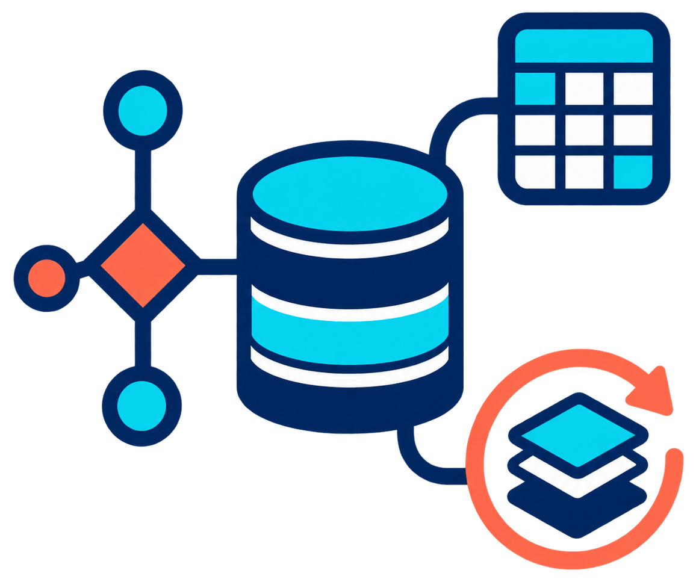

<h1 hidden>BD - PostgreSQL</h1>

  
  

    Bases de Datos con PostgreSQL
    DDL, DML y DQL
  

Bienvenidos al material de apoyo y documentación del curso de **Bases de Datos con PostgreSQL**. Utiliza el menú superior para navegar por los contenidos de DDL, DML y DQL.

Empieza preparando [PostgreSQL con Docker Compose](entorno_postgresql.md) y [DBeaver](2_client_dbeaver_installaci_i_confiuraci.md). Después crea las bases en DDL, carga y modifica sus datos en DML y realiza las consultas en DQL.
